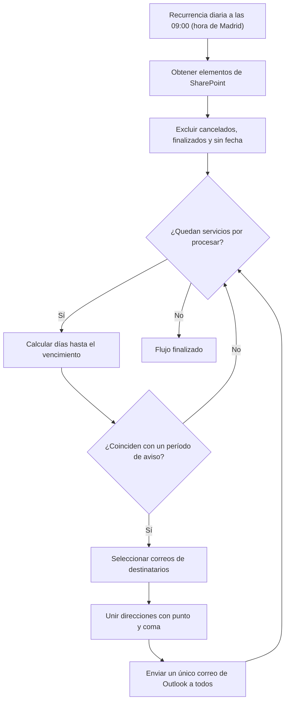

# Avisos de caducidad de servicios | Power Automate

[English](README.md)

## Descripción
Flujo de nube programado que consulta fechas de vencimiento en una lista de SharePoint y envía un correo a los usuarios asignados cuando los días restantes coinciden con alguno de los períodos de aviso seleccionados.

## Requisitos
- Lista de SharePoint / Microsoft Lists
- Power Automate con conexión a SharePoint
- Conexión a Office 365 Outlook para enviar notificaciones

## Estructura mínima de la lista de SharePoint

| Nombre visible (ejemplo) | Nombre interno | Tipo de columna | Requisitos |
|---|---|---|---|
| Servicio | `Title` | Una línea de texto | Identifica el servicio y se utiliza en el correo |
| Fecha de vencimiento | `Fechadevencimiento` | Fecha y hora (recomendado: solo fecha) | Debe tener fecha para procesarse |
| Período de aviso | `Periododeaviso` | Elección, permitir varias selecciones | Opciones de texto numérico como `90`, `30`, `15` |
| Comunicar a | `Comunicara` | Persona o grupo, permitir varias selecciones | Obligatorio; los usuarios deben disponer de correo |
| Estado | `Estado` | Elección única o texto | Se excluyen `90-Cancelado` y `40-Finalizado` |

**Nota:** Los nombres internos corresponden a la implementación. Si se crea una lista nueva, deben coincidir o habrá que adaptar las expresiones. `Title` es el campo supuesto para el nombre del servicio: conviene verificarlo. Que los demás campos estén marcados como obligatorios en SharePoint depende de la configuración de la lista.

## Funcionamiento del flujo
1. **Recurrencia:** ejecución diaria, a las 09:00, con zona horaria de Madrid.
2. **Obtener elementos:** excluir registros cancelados, finalizados y sin fecha mediante OData:
   ```text
   Estado ne '90-Cancelado' and Estado ne '40-Finalizado' and Fechadevencimiento ne null
   ```
3. **Aplicar a cada servicio:** calcular los días naturales restantes hasta `Fechadevencimiento`.
4. **Comprobar período de aviso:** verificar la coincidencia exacta entre los días restantes y las opciones de `Periododeaviso`.
5. **Seleccionar correos:** extraer `Email` de cada persona en `Comunicara`.
6. **Combinación:** unir las direcciones con `;`.
7. **Enviar un correo electrónico (V2):** un único mensaje por servicio que cumpla el plazo, dirigido a todos sus destinatarios.

## Diagrama del flujo



El diagrama refleja las acciones del flujo publicado. No representa gestión adicional de errores, deduplicación ni registro de notificaciones enviadas.

## Ejemplo
Un servicio que vence en 30 días y tiene seleccionados `90`, `30`, `15` genera un aviso hoy. Si solo tiene seleccionado `90`, no se envía.

## Consideraciones técnicas
- SharePoint puede devolver las opciones múltiples como objetos con `Value`. Verificar la salida real de **Obtener elementos** antes de cerrar la condición.
- En **Seleccionar**, utilizar modo texto y la expresión `item()?['Email']`, para que **Combinación** reciba una matriz de cadenas y no objetos.
- No es necesario un segundo **Aplicar a cada uno** para los destinatarios si se desea un único mensaje para todos.
- Activar paginación si se supera el límite predeterminado de elementos recuperados.
- Si se ejecuta el flujo varias veces el mismo día, puede repetir los avisos. Esta versión no registra notificaciones ya enviadas.
- Probar con un registro aislado o filtrando por su ID antes de habilitar el envío en producción.
- No se incluyen URL internas, correos personales ni credenciales.

## Estado
**Probado y operativo:** El flujo original de Power Automate se ha probado correctamente en su entorno de origen. Los JSON anonimizados siguientes son definiciones de referencia, no soluciones completas de Power Platform listas para importar.

- [Definición del flujo en inglés](solution/Workflows/service-expiration-alerts.en.json)
- [Definición del flujo en castellano](solution/Workflows/service-expiration-alerts.es.json)

Para reutilizar una definición hay que configurar el sitio y la lista de SharePoint, sustituir el identificador ficticio de la lista, configurar las conexiones de SharePoint y Office 365 Outlook, verificar los nombres de columna y valores de estado, y probarla en el entorno de destino. Las copias publicadas no se han validado de forma independiente después de anonimizarlas.

**Detalle conocido de la plantilla:** El apartado «Días restantes» del correo muestra de nuevo la fecha de vencimiento en lugar del número de días calculado.
