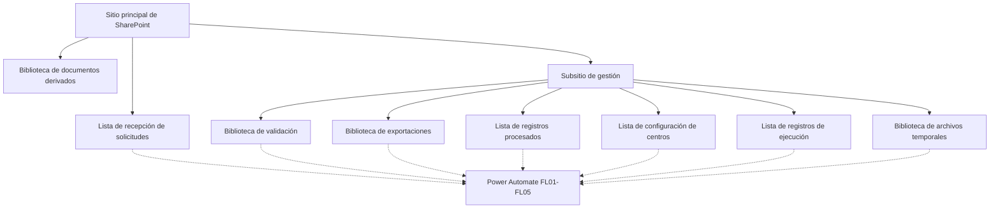

# Arquitectura y personalizaciones de SharePoint Online

## Descripción general

Esta carpeta documenta la arquitectura de SharePoint Online, la configuración de seguridad, las bibliotecas de documentos, las listas y las personalizaciones JSON utilizadas en el proyecto de automatización de SharePoint y Excel.

La solución combina SharePoint Online, Microsoft Lists, Power Automate y Office Scripts para gestionar la recepción de solicitudes, la validación documental, el procesamiento de Excel, la creación de registros y el acceso controlado a la información.

La arquitectura se presenta como una demostración reutilizable para un portfolio, basada en escenarios empresariales ficticios.

No se incluyen direcciones URL de producción, credenciales, identificadores reales de organizaciones ni información confidencial.

## Tecnologías

- SharePoint Online
- Microsoft Lists
- Formato JSON de SharePoint
- Power Automate
- Office Scripts
- Microsoft Excel

## Arquitectura de la solución

La solución utiliza dos ubicaciones de SharePoint:

1. **Sitio principal de SharePoint:** permite presentar solicitudes y consultar los documentos derivados.
2. **Subsitio de gestión:** contiene los recursos internos de validación, procesamiento, configuración y registro de ejecuciones.

El subsitio de gestión depende del sitio principal de SharePoint; no es una colección de sitios independiente.

La arquitectura separa las funcionalidades dirigidas a usuarios externos de las operaciones internas de gestión.

### Diagrama de arquitectura



Las conexiones discontinuas representan la integración con la solución general de Power Automate, no relaciones directas entre todos los recursos y todos los flujos.

## Estructura del repositorio

```text
Sharepoint/
├── README.md
├── architecture/
│   └── sites-architecture.md
├── sites/
│   ├── main-site.md
│   └── management-subsite.md
├── lists/
│   ├── request-intake.md
│   ├── processed-records.md
│   ├── centers-configuration.md
│   └── processing-logs.md
├── libraries/
│   ├── derived-documents.md
│   ├── temporary-files-library.md
│   ├── validation-library.md
│   └── export-library.md
├── forms/
│   └── request-intake-form.json
└── formatting/
    ├── request-intake-view.json
    └── document-library-commandbar.json
```

## Documentación de arquitectura

| Documento | Descripción |
|---|---|
| [Arquitectura de sitios](architecture/sites-architecture.md) | Jerarquía de sitios de SharePoint, recursos y modelo de seguridad |
| [Sitio principal](sites/main-site.md) | Recepción de solicitudes de usuarios externos y consulta de documentos |
| [Subsitio de gestión](sites/management-subsite.md) | Recursos de procesamiento interno y controles de acceso |

## Listas de SharePoint

### Lista de recepción de solicitudes

[Ver documentación](lists/request-intake.md)

Ubicada en el sitio principal de SharePoint.

Permite al personal externo autorizado presentar solicitudes mediante un formulario personalizado de SharePoint.

Los campos visibles para el usuario incluyen:

- Observaciones.
- Archivos Excel adjuntos.

La lista también contiene los campos estándar del sistema de SharePoint.

### Lista de registros procesados

[Ver documentación](lists/processed-records.md)

Ubicada en el subsitio de gestión.

Almacena los registros principales y asociados generados durante el procesamiento de Excel.

La solución utiliza:

- Registros principales identificados como `T`.
- Registros asociados identificados como `B`.
- Relaciones mediante `ParentRecordId`.
- Permisos por elemento basados en el centro, gestionados por FL05.

### Lista de configuración de centros

[Ver documentación](lists/centers-configuration.md)

Almacena la configuración de centros y las referencias a grupos de SharePoint.

La lista incluye:

- Centro (`Center`).
- ID del grupo de SharePoint.
- Enlace de administración del grupo.

FL05 utiliza los identificadores de grupo configurados al asignar permisos a los registros.

### Lista de registros de ejecución

[Ver documentación](lists/processing-logs.md)

Almacena la información de las ejecuciones generada mediante FL04.

La arquitectura de registro permite:

- Trazabilidad de las ejecuciones.
- Consulta de resultados del procesamiento.
- Seguimiento de errores.
- Resúmenes de creación de registros.
- Información de diagnóstico.

El personal externo y los grupos de centros no tienen acceso a esta lista.

## Bibliotecas de documentos

### Biblioteca de documentos derivados

[Ver documentación](libraries/derived-documents.md)

Ubicada en el sitio principal de SharePoint.

Proporciona acceso de solo lectura a los documentos derivados para los usuarios autorizados, incluido el personal externo cuando corresponda.

### Biblioteca de validación

[Ver documentación](libraries/validation-library.md)

Ubicada en el subsitio de gestión.

Almacena documentos Excel pendientes de validación y procesamiento.

FL02 procesa los documentos con estado `Validated`, los cambia a `Processing` durante la ejecución y los marca como `Processed` al finalizar correctamente o como `Error` si el procesamiento falla.

El flujo también protege los documentos de origen interrumpiendo la herencia de permisos a nivel de archivo y asignando permisos de solo lectura a los grupos Owners y Members.

### Biblioteca de archivos temporales

[Ver documentación](libraries/temporary-files-library.md)

Ubicada en el subsitio de gestión.

Almacena los libros Excel temporales generados durante el procesamiento de FL02.

FL03 intenta eliminar periódicamente los archivos temporales con más de ocho horas de antigüedad.

Los errores de eliminación, incluidos los provocados por bloqueos activos de archivos Excel, se tratan mediante mensajes de diagnóstico. El flujo no comprueba explícitamente si un archivo sigue siendo necesario para una operación de procesamiento activa.

El acceso está restringido a las cuentas autorizadas de gestión y automatización.

### Biblioteca de exportaciones

[Ver documentación](libraries/export-library.md)

Ubicada en el subsitio de gestión.

Almacena los libros Excel generados por el flujo de procesamiento.

Los grupos Owners, Members y los grupos de centros tienen acceso de solo lectura.

Una conexión autorizada de Power Automate realiza las operaciones necesarias de creación y actualización de archivos.

## Personalizaciones JSON

El formato JSON de SharePoint se utiliza para personalizar elementos compatibles de la interfaz.

Estas personalizaciones mejoran la usabilidad, pero no sustituyen los permisos de SharePoint.

### Vista de recepción de solicitudes

[Ver JSON](formatting/request-intake-view.json)

Personaliza la barra de comandos de la lista de recepción de solicitudes.

Entre sus funciones se incluyen:

- Cambiar el nombre del comando New a New Request.
- Ocultar la edición en cuadrícula.
- Ocultar los comandos para compartir y copiar enlaces.
- Ocultar las opciones de exportación.
- Ocultar comandos de automatización e integración no esenciales.

### Barra de comandos de bibliotecas documentales

[Ver JSON](formatting/document-library-commandbar.json)

Proporciona una barra de comandos simplificada para determinadas bibliotecas documentales.

Según la interfaz compatible, puede:

- Destacar la edición en cuadrícula.
- Ocultar los comandos de carga y creación.
- Ocultar los comandos de eliminación, cambio de nombre, movimiento y copia.
- Ocultar las opciones de uso compartido y exportación.
- Reducir las acciones innecesarias de la interfaz.

El mismo formato puede adaptarse a bibliotecas con diferentes modelos de permisos.

El JSON debe probarse en la interfaz de SharePoint prevista.

### Formulario de recepción de solicitudes

[Ver JSON](forms/request-intake-form.json)

Contiene una configuración conceptual de diseño para el formulario de la lista de recepción de solicitudes.

El diseño hace referencia a:

- Observaciones.
- Archivos adjuntos.

El control estándar de archivos adjuntos de SharePoint debe habilitarse y validarse por separado.

El JSON no crea columnas, no habilita los adjuntos ni aprovisiona la lista.

## Modelo de seguridad

La solución utiliza varias capas de seguridad de SharePoint.

### Seguridad a nivel de sitio

El sitio principal de SharePoint permite el acceso al personal externo autorizado y a los usuarios de gestión.

El subsitio de gestión restringe el acceso a los recursos internos según los roles de usuario.

### Seguridad a nivel de biblioteca

Cada biblioteca aplica reglas de acceso adecuadas a su finalidad.

Algunos ejemplos son:

- Acceso de solo lectura a los documentos derivados.
- Acceso restringido a los documentos de validación.
- Acceso de solo lectura a los archivos de exportación generados.

### Seguridad a nivel de elemento

FL05 asigna permisos a los registros procesados según el centro al que pertenecen.

Cada grupo de centro solo puede acceder a los registros autorizados para ese centro.

### Protección de documentos procesados

FL02 aplica cambios de permisos a nivel de archivo sobre los documentos validados.

Los administradores de la colección de sitios conservan el control administrativo.

### Principio de seguridad importante

**El formato JSON de SharePoint no constituye una barrera de seguridad.**

Ocultar un botón no impide realizar una operación si el usuario sigue teniendo permiso para ejecutarla desde otra interfaz.

La seguridad real debe implementarse mediante permisos de SharePoint y una configuración adecuada.

## Integración con Power Automate

La arquitectura de SharePoint se integra con cinco flujos conceptuales de Power Automate.

| Flujo | Responsabilidad |
|---|---|
| FL01 | Recupera adjuntos Excel de la lista de recepción de solicitudes, crea copias en las bibliotecas de documentos derivados y de validación, y aplica permisos a los elementos de solicitud. |
| FL02 | Procesa archivos Excel validados, protege los documentos de origen, crea registros principales y asociados y genera libros de exportación. |
| FL03 | Elimina archivos temporales de procesamiento con más de ocho horas de antigüedad. |
| FL04 | Crea registros de ejecución y devuelve el identificador `Id_Log` a FL02. |
| FL05 | Aplica permisos por elemento basados en el centro a los registros procesados utilizando la lista de configuración de centros. |

### Coordinación entre flujos

FL01 gestiona la recepción y distribución de documentos entre el sitio principal de SharePoint y el subsitio de gestión.

FL02 gestiona el ciclo de procesamiento de los documentos validados.

FL04 proporciona el registro de ejecuciones, mientras que FL05 administra los permisos de los registros específicos de cada centro.

FL03 realiza de forma independiente la limpieza de archivos temporales según la programación configurada.

Los flujos están documentados en los directorios `flows/` y `docs/` del proyecto principal.

## Consideraciones de implementación

La arquitectura está pensada para adaptarse a distintos entornos.

Las tareas de implementación pueden incluir:

1. Crear los sitios y recursos necesarios de SharePoint.
2. Configurar las columnas de las listas y las bibliotecas documentales.
3. Asignar permisos a nivel de sitio, biblioteca y elemento.
4. Habilitar los archivos adjuntos en la lista de recepción de solicitudes.
5. Aplicar las personalizaciones JSON compatibles.
6. Configurar las conexiones de Power Automate.
7. Adaptar las plantillas Excel y los Office Scripts.
8. Probar los flujos con datos ficticios.
9. Validar los permisos efectivos de cada rol de usuario.

La documentación no aprovisiona automáticamente el entorno de SharePoint.

## Reutilización

La solución muestra patrones reutilizables para:

- Gestión de solicitudes.
- Validación documental.
- Automatización de Excel.
- Relaciones entre registros de SharePoint.
- Acceso basado en roles y permisos a nivel de elemento.
- Registro de ejecuciones.
- Personalización de la interfaz.
- Separación entre recursos orientados a usuarios externos y recursos internos.

Los ejemplos están destinados al aprendizaje, la demostración y su presentación en un portfolio profesional.

## Estado de la documentación

**Estado: documentación de la arquitectura y los recursos de SharePoint completada.**

Se han documentado los siguientes componentes:

- Sitio principal de SharePoint y subsitio de gestión.
- Jerarquía de sitios de SharePoint y arquitectura de seguridad.
- Cuatro listas de SharePoint y sus responsabilidades funcionales.
- Cuatro bibliotecas documentales y sus modelos de acceso.
- Ejemplo de diseño del formulario de recepción de solicitudes.
- Dos ejemplos de personalización JSON de barras de comandos de SharePoint.
- Ciclo de validación y protección documental.
- Relaciones entre registros principales y asociados.
- Gestión de permisos por elemento basados en el centro.
- Registros de ejecución y trazabilidad.
- Integración con los flujos FL01 a FL05 de Power Automate.

### Validación de la implementación

Las siguientes actividades requieren validación en un entorno de SharePoint de destino:

- Configuración del sitio y del subsitio.
- Aprovisionamiento de listas y bibliotecas.
- Pertenencia a grupos de SharePoint y permisos efectivos.
- Herencia de permisos a nivel de recurso y elemento.
- Funcionamiento de los archivos adjuntos del formulario de solicitudes.
- Compatibilidad del formato JSON.
- Conexiones y permisos de ejecución de Power Automate.
- Integración del procesamiento de Excel y Office Scripts.
- Pruebas integrales de los flujos y de la seguridad.

### Alcance del portfolio

Este repositorio proporciona documentación conceptual de arquitectura y algunos ejemplos reutilizables de configuración.

No contiene un paquete de aprovisionamiento de SharePoint completamente desplegable.

Todos los ejemplos utilizan escenarios ficticios y excluyen credenciales de producción, identificadores reales de organizaciones e información empresarial confidencial.
