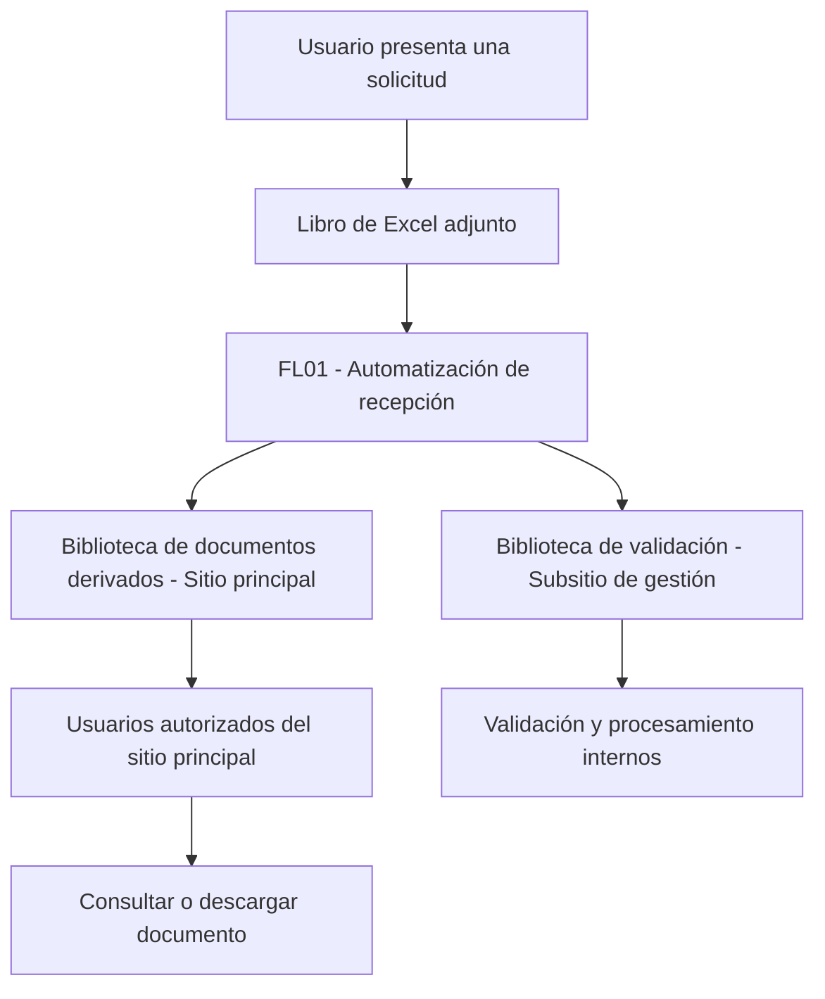

# Biblioteca de documentos derivados

## 1. Descripción general

La biblioteca de documentos derivados (*Derived Documents Library*) es una biblioteca de documentos de SharePoint Online ubicada en el sitio principal de SharePoint.

Almacena las copias de documentos Excel que FL01 crea automáticamente cuando se presenta una nueva solicitud mediante la lista de recepción de solicitudes.

Todos los usuarios autorizados del sitio principal, incluidos Site Owners, Site Members y el personal externo, tienen acceso de solo lectura a estos documentos. Pueden consultarlos y descargarlos sin modificarlos.

> **Aviso sobre el portfolio:** Esta documentación describe una demostración conceptual con nombres y ejemplos ficticios. No incluye direcciones URL de producción, credenciales, identificadores reales ni información empresarial confidencial.

## 2. Configuración de la biblioteca

| Propiedad | Configuración |
|---|---|
| Nombre de la biblioteca | Derived Documents Library |
| Ubicación | Sitio principal de SharePoint |
| Tipo | Biblioteca de documentos de SharePoint |
| Finalidad principal | Consulta de solo lectura de las copias de documentos Excel creadas por FL01 |
| Site Owners | Lectura |
| Site Members | Lectura |
| Personal externo autorizado | Lectura |
| Creación de documentos | FL01 mediante una conexión autorizada de Power Automate |
| Modificación de documentos | Restringida a conexiones de automatización autorizadas y administradores de la colección de sitios |

## 3. Finalidad

La biblioteca ofrece una ubicación centralizada y de solo lectura donde los usuarios autorizados del sitio principal pueden acceder a las copias de Excel creadas por FL01 inmediatamente después de presentar la solicitud y completar correctamente la distribución documental.

Sus objetivos principales son:

- Centralizar el acceso a los documentos derivados.
- Ofrecer una experiencia de consulta documental coherente.
- Separar los documentos derivados de los adjuntos originales de las solicitudes.
- Permitir la descarga de documentos a los usuarios autorizados.
- Impedir modificaciones no autorizadas.
- Facilitar la trazabilidad y la gestión documental.

La biblioteca complementa la lista de recepción de solicitudes del sitio principal.

## 4. Integración con el sitio principal

El sitio principal de SharePoint es el punto de entrada de la solución para los usuarios.

Sus recursos principales son:

- **Lista de recepción de solicitudes:** permite al personal externo presentar solicitudes mediante un formulario personalizado de SharePoint.
- **Biblioteca de documentos derivados:** proporciona acceso de solo lectura a los documentos disponibles para los usuarios autorizados.

El subsitio de gestión contiene los recursos internos de validación, procesamiento, configuración y registro de ejecuciones.

Esta separación permite distinguir las funciones orientadas al personal externo de las operaciones internas de gestión.

## 5. Ciclo de vida documental

El ciclo de vida comienza cuando un usuario autorizado crea un elemento en la lista de recepción de solicitudes y adjunta un libro de Excel.

FL01 realiza la distribución inicial:

1. Un usuario autorizado presenta una solicitud y adjunta un libro de Excel.
2. FL01 recupera el adjunto de Excel de la lista de recepción de solicitudes.
3. FL01 crea una copia en la biblioteca de documentos derivados, ubicada en el sitio principal.
4. FL01 crea otra copia independiente en la biblioteca de validación, ubicada en el subsitio de gestión.
5. La biblioteca de documentos derivados proporciona acceso de solo lectura a los usuarios autorizados del sitio principal, incluidos el personal externo, Site Members y Site Owners.
6. La biblioteca de validación aplica su propio modelo de permisos restringidos para la validación interna y el procesamiento posterior.

La biblioteca de documentos derivados no depende de FL02 ni de un flujo de publicación adicional para recibir la copia inicial.

Las dos copias tienen finalidades diferentes y siguen requisitos de control de acceso independientes.

## 6. Permisos

La biblioteca utiliza un modelo de acceso de solo lectura para los usuarios ordinarios.

| Rol | Acceso |
|---|---|
| Administradores de la colección de sitios | Control administrativo |
| Site Owners | Lectura |
| Site Members | Lectura |
| Personal externo autorizado | Lectura |
| Usuarios no autorizados | Sin acceso |
| Conexión de automatización autorizada | Permisos necesarios para crear y administrar copias documentales |

El permiso de lectura permite abrir y descargar documentos sin conceder derechos de edición.

La configuración efectiva de permisos debe validarse en el entorno de destino.

## 7. Arquitectura de seguridad

La biblioteca de documentos derivados se encuentra en el sitio principal porque permite la consulta documental autorizada.

No debe exponer los recursos internos del subsitio de gestión.

Los requisitos de seguridad incluyen:

- Restringir la modificación de documentos.
- Conceder acceso únicamente a los usuarios autorizados.
- Impedir el acceso a los registros internos de procesamiento.
- Evitar la exposición de documentos de validación.
- Aplicar el principio de mínimo privilegio.
- Revisar los accesos cuando los documentos contengan información sensible.

Si distintos usuarios deben acceder a documentos diferentes, puede ser necesario establecer permisos adicionales a nivel de documento.

Esta decisión corresponde a la implementación y no se presupone en la demostración actual.

## 8. Flujo de acceso a documentos

FL01 crea dos copias independientes del adjunto Excel.

- **Biblioteca de documentos derivados:** ofrece acceso de solo lectura a los usuarios autorizados del sitio principal, incluidos el personal externo, Site Members y Site Owners.
- **Biblioteca de validación:** almacena la copia independiente utilizada para la validación interna y el procesamiento posterior.

La biblioteca de documentos derivados recibe su copia directamente de FL01. No es necesario un flujo de publicación adicional.

## 9. Organización documental

La biblioteca puede utilizar metadatos y vistas de SharePoint para facilitar la navegación.

Entre las posibles opciones de configuración se incluyen:

- Tipo de documento.
- Fecha de creación.
- Referencia de la solicitud.
- Referencia del procesamiento.
- Estado del documento.
- Vistas personalizadas.
- Convenciones para nombrar archivos.

Estas opciones son ejemplos de configuración opcionales.

La estructura exacta de metadatos debe definirse según los requisitos de la implementación.

## 10. Experiencia de usuario

La biblioteca debe ofrecer una experiencia de consulta sencilla y coherente.

Entre las recomendaciones de diseño se incluyen:

- Nombres de documento claros.
- Columnas de metadatos útiles.
- Vistas de biblioteca simplificadas.
- Filtros y ordenación adecuados.
- Acceso de solo lectura para usuarios ordinarios.
- Navegación coherente desde el sitio principal.

Puede utilizarse formato JSON de SharePoint para personalizar la interfaz.

No obstante, la personalización visual no sustituye la gestión de permisos de SharePoint.

## 11. Integración con Power Automate

La biblioteca de documentos derivados forma parte de la solución global de Power Automate.

### FL01 - Recepción de solicitudes

FL01 se inicia cuando se presenta una nueva solicitud en la lista de recepción de solicitudes con un libro de Excel adjunto.

El flujo recupera el adjunto y crea dos copias documentales independientes:

- Una copia en la biblioteca de documentos derivados, ubicada en el sitio principal.
- Una copia en la biblioteca de validación, ubicada en el subsitio de gestión.

La biblioteca de documentos derivados proporciona acceso de solo lectura a los usuarios autorizados del sitio principal, incluidos el personal externo, Site Members y Site Owners.

No se requiere ningún flujo adicional de publicación documental.

### FL02 - Procesamiento de Excel

FL02 procesa los libros de Excel validados de la biblioteca de validación del subsitio de gestión.

Crea registros de SharePoint y genera libros de exportación sin modificar la copia almacenada en la biblioteca de documentos derivados.

### FL04 - Registros de ejecución

FL04 registra información sobre las ejecuciones de procesamiento en el subsitio de gestión.

### FL05 - Permisos de registros

FL05 aplica permisos basados en centros a los registros procesados del subsitio de gestión.

La biblioteca de documentos derivados mantiene su propio modelo de acceso de solo lectura y no hereda los permisos a nivel de registro administrados por FL05.

## 12. Consideraciones de seguridad y gobernanza

- Utilizar los permisos de SharePoint para controlar el acceso.
- Validar los permisos efectivos de solo lectura de Site Owners, Site Members y personal externo autorizado después de que FL01 cree la copia documental.
- Restringir las modificaciones a identidades autorizadas.
- Evitar compartir documentos confidenciales mediante enlaces sin restricciones.
- Revisar los requisitos de conservación documental.
- Considerar el historial de versiones cuando corresponda.
- Auditar el acceso a los documentos según los requisitos de la organización.
- No publicar direcciones URL de producción ni información de configuración sensible en repositorios públicos.

## 13. Documentación relacionada

- [Sitio principal de SharePoint](../sites/main-site.md)
- [Lista de recepción de solicitudes](../lists/request-intake.md)
- [Subsitio de gestión](../sites/management-subsite.md)
- [Biblioteca de validación](validation-library.md)
- [Biblioteca de exportaciones](export-library.md)
- [Arquitectura de sitios de SharePoint](../architecture/sites-architecture.md)
- [Descripción general de SharePoint](../README.md)

## 14. Estado de la documentación

**Estado:** Documentación conceptual de la biblioteca completada.

Los siguientes detalles de implementación siguen siendo configurables:

- Configuración de la conexión de FL01 y detalles de ejecución de la copia documental.
- Columnas de metadatos de la biblioteca.
- Convenciones de nomenclatura de documentos.
- Permisos de usuarios y grupos.
- Políticas de conservación documental.
- Vistas de biblioteca y formato de la interfaz.

Este documento no es una plantilla automatizada para aprovisionar bibliotecas de SharePoint.
