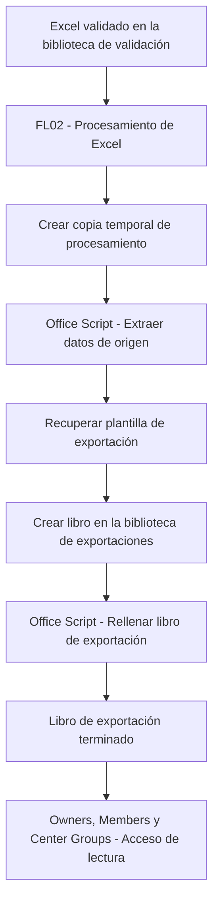

# Biblioteca de exportaciones

## 1. Descripción general

La biblioteca de exportaciones (*Export Library*) es una biblioteca de documentos de SharePoint Online ubicada en el subsitio de gestión.

Proporciona un almacenamiento centralizado para los libros de Excel generados por la solución de procesamiento automatizado.

La biblioteca separa los documentos de salida generados de los archivos originales almacenados en la biblioteca de validación.

> **Aviso sobre el portfolio:** Esta documentación describe una demostración conceptual. Todos los nombres y ejemplos son ficticios. No se incluyen URL de producción, credenciales, identificadores reales ni información empresarial confidencial.

## 2. Configuración de la biblioteca

| Propiedad | Configuración |
|---|---|
| Nombre de la biblioteca | Export Library |
| Ubicación | Subsitio de gestión |
| Tipo de biblioteca | Biblioteca de documentos de SharePoint |
| Formato documental | Libros de Excel |
| Generación de archivos | Power Automate FL02 |
| Acceso de usuarios | Solo lectura |
| Barra de comandos | Personalizable mediante formato JSON de SharePoint |

## 3. Finalidad

La biblioteca de exportaciones almacena documentos Excel estructurados que se generan durante el ciclo de procesamiento.

Sus objetivos principales son:

- Centralizar los libros de Excel generados.
- Proporcionar una ubicación coherente para los archivos de salida procesados.
- Permitir que los usuarios autorizados consulten y descarguen archivos.
- Separar los documentos originales de los documentos generados.
- Facilitar la trazabilidad documental.

La estructura de la biblioteca puede adaptarse a diferentes necesidades empresariales.

## 4. Proceso de generación de exportaciones

FL02 genera un libro de Excel de exportación como parte del flujo de procesamiento de documentos validados.

El proceso utiliza una plantilla de Excel y Office Scripts para transformar la información validada de origen en un libro de salida estructurado.

La secuencia conceptual es la siguiente:

1. FL02 detecta un documento Excel validado en la biblioteca de validación.
2. FL02 recupera el libro de origen y crea una copia temporal de procesamiento.
3. Un Office Script extrae y estructura los datos del libro de origen.
4. FL02 recupera la plantilla de Excel de exportación predefinida.
5. FL02 crea un nuevo libro en la biblioteca de exportaciones utilizando la plantilla.
6. Un segundo Office Script rellena el libro generado con los datos extraídos.
7. El libro de exportación terminado queda disponible en la biblioteca de exportaciones.
8. Los Site Owners, Site Members y Center Groups autorizados pueden consultar y descargar el documento generado con permisos de solo lectura.

La generación de exportaciones forma parte de FL02 y no requiere un flujo de Power Automate independiente.

El flujo FL02 completo también incluye la creación de registros de SharePoint, la gestión de errores, el registro de ejecuciones mediante FL04 y la limpieza de archivos temporales mediante FL03.

## 5. Integración con Office Scripts

FL02 utiliza dos Office Scripts para extraer información del libro de origen validado y rellenar el libro de exportación generado.

### Extracción de datos de origen

[Ver process-records.ts](../../office-scripts/process-records.ts)

El primer Office Script procesa la copia temporal del libro de Excel validado.

Su finalidad es:

- Leer y estructurar los datos del libro de origen.
- Preparar la información extraída para las operaciones posteriores de Power Automate.
- Devolver los datos procesados a FL02.

### Rellenado del libro de exportación

[Ver populate-export-template.ts](../../office-scripts/populate-export-template.ts)

El segundo Office Script se ejecuta sobre el libro creado a partir de la plantilla de exportación.

Su finalidad es:

- Recibir la información estructurada preparada durante la extracción.
- Rellenar el libro de exportación.
- Preparar el archivo Excel generado para su consulta y descarga.

### Consideraciones de integración

Los Office Scripts se ejecutan mediante Power Automate utilizando una conexión debidamente autorizada.

La estructura de la plantilla de Excel, las columnas de origen y las correspondencias entre campos pueden adaptarse a los requisitos de cada implementación.

Los scripts son ejemplos de demostración y deben probarse con las plantillas de Excel y las estructuras de datos previstas.

## 6. Permisos

La biblioteca de exportaciones proporciona acceso de solo lectura a los usuarios autorizados de gestión y a los grupos de centros.

| Rol | Permiso |
|---|---|
| Site Collection Administrators | Control administrativo |
| Site Owners | Lectura |
| Site Members | Lectura |
| Center Groups | Lectura |
| External Staff | Sin acceso |

Los permisos permiten a los usuarios autorizados visualizar y descargar los archivos generados sin concederles capacidades ordinarias de edición.

FL02 utiliza una conexión de Power Automate debidamente autorizada para crear y rellenar los libros de exportación.

La conexión de automatización debe disponer de permisos suficientes para realizar estas operaciones.

## 7. Personalización de la biblioteca de documentos

La solución incluye formato JSON para la barra de comandos de SharePoint.

El archivo de demostración existente está disponible en:

[JSON de la barra de comandos de la biblioteca de documentos](../formatting/document-library-commandbar.json)

El formato de la barra de comandos permite:

- Personalizar los comandos visibles.
- Cambiar el nombre de las acciones.
- Simplificar la interfaz de usuario.
- Destacar las operaciones relevantes de la biblioteca.

El JSON de demostración debe revisarse y adaptarse a la experiencia prevista para la biblioteca.

**Importante:** El formato JSON no aplica los permisos de SharePoint.

Por ejemplo, ocultar un comando de edición no elimina el permiso subyacente que pueda tener un usuario para editar documentos.

## 8. Diagrama del flujo de exportación

El diagrama ilustra la secuencia de generación de exportaciones dentro de FL02.

El flujo completo también incluye la creación de registros de SharePoint, la gestión de errores, los registros de procesamiento mediante FL04 y la limpieza de archivos temporales mediante FL03.

El libro generado se almacena en la biblioteca de exportaciones del subsitio de gestión, donde los Site Owners, Site Members y Center Groups autorizados disponen de acceso de solo lectura.

## 9. Organización documental

Los documentos generados pueden organizarse según las necesidades operativas.

Entre las estrategias posibles se incluyen:

- Convenciones para nombrar archivos.
- Fecha de creación.
- Referencias a documentos de origen.
- Identificadores de ejecución del procesamiento.
- Columnas de metadatos adicionales.
- Vistas de SharePoint.

Estas son opciones de diseño, no elementos de configuración obligatorios.

La organización concreta debe adaptarse a cada implementación.

## 10. Consideraciones de seguridad

- Aplicar el principio de mínimo privilegio.
- Limitar a permisos de solo lectura el acceso de los usuarios ordinarios.
- Utilizar una conexión de automatización autorizada para crear archivos.
- Comprobar los permisos efectivos de los usuarios que pertenecen a varios grupos.
- Evitar que usuarios externos no autorizados accedan a los archivos generados.
- No utilizar el formato JSON como mecanismo de seguridad.
- Revisar los accesos cuando los libros generados contengan información sensible.
- Validar los permisos en un entorno de pruebas controlado.

## 11. Documentación relacionada

- [Subsitio de gestión](../sites/management-subsite.md)
- [Biblioteca de validación](validation-library.md)
- [Arquitectura de sitios de SharePoint](../architecture/sites-architecture.md)
- [JSON de la barra de comandos de la biblioteca de documentos](../formatting/document-library-commandbar.json)
- [Descripción general de SharePoint](../README.md)

## 12. Estado de la documentación

**Estado:** Documentación conceptual de la biblioteca completada.

Los siguientes detalles de implementación siguen siendo configurables:

- Estructura de la plantilla de exportación.
- Convenciones para nombrar documentos.
- Columnas de metadatos adicionales.
- Permisos de la conexión de automatización.
- Formato de la barra de comandos específico de la biblioteca.

Este documento no constituye una plantilla automatizada de aprovisionamiento de bibliotecas de SharePoint.
