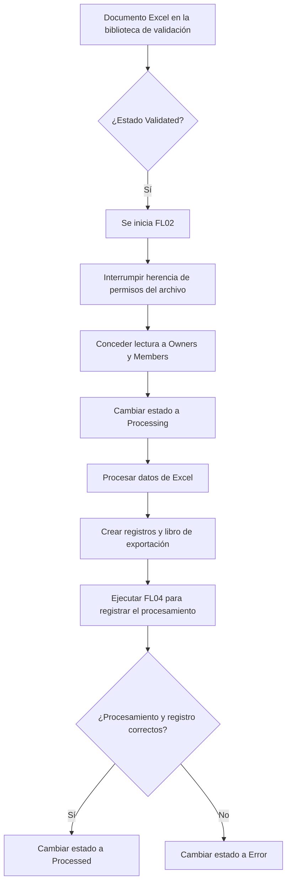

# Biblioteca de validación

## 1. Descripción general

La biblioteca de validación (*Validation Library*) es una biblioteca de documentos de SharePoint Online ubicada en el subsitio de gestión.

Almacena libros de Excel pendientes de validación y procesamiento mediante Power Automate.

La biblioteca implementa seguridad a nivel de documento para proteger los archivos validados frente a modificaciones no autorizadas.

> **Aviso sobre el portfolio:** Esta documentación describe una demostración conceptual con nombres ficticios. No incluye direcciones URL de producción, credenciales, identificadores reales ni información confidencial.

## 2. Configuración de la biblioteca

| Propiedad | Configuración |
|---|---|
| Nombre de la biblioteca | Validation Library |
| Ubicación | Subsitio de gestión |
| Tipo de biblioteca | Biblioteca de documentos de SharePoint |
| Formato documental | Libros de Excel |
| Flujo de procesamiento | FL02 |
| Modelo de seguridad | Permisos a nivel de biblioteca y de archivo |
| Acceso del personal externo | No permitido |
| Acceso de los grupos de centros | No permitido |

## 3. Ciclo de vida documental

Los documentos llegan a la biblioteca de validación a través de FL01, que se inicia cuando se presenta una nueva solicitud en el sitio principal de SharePoint.

El ciclo de vida documental es el siguiente:

1. Un usuario autorizado presenta una solicitud con un libro de Excel adjunto mediante la lista de recepción de solicitudes.
2. FL01 recupera el archivo Excel adjunto.
3. FL01 crea una copia en la biblioteca de documentos derivados del sitio principal de SharePoint.
4. FL01 crea otra copia independiente en la biblioteca de validación del subsitio de gestión.
5. Los Site Owners y Site Members autorizados revisan y validan el documento.
6. El estado del documento cambia a `Validated`, lo que desencadena FL02.
7. FL02 interrumpe la herencia de permisos del archivo y concede acceso de lectura a Site Owners y Site Members.
8. FL02 cambia el estado del documento de `Validated` a `Processing`.
9. FL02 procesa los datos de Excel, crea registros de SharePoint, genera el libro de exportación y registra los resultados del procesamiento mediante FL04.
10. FL02 actualiza el estado del documento a `Processed` cuando el procesamiento y el registro de ejecución terminan correctamente, o a `Error` si el procesamiento no puede completarse satisfactoriamente.

La biblioteca de validación está restringida a los usuarios de gestión autorizados. El personal externo y los grupos de centros no pueden acceder a sus documentos.

El estado `Processing` indica que el documento ha entrado en la fase protegida de procesamiento. No garantiza que las operaciones posteriores hayan terminado correctamente.

El estado `Processed` indica que el proceso ha finalizado satisfactoriamente, mientras que `Error` identifica errores de procesamiento o del registro de ejecución.

## 4. Estados del documento

El flujo de procesamiento utiliza metadatos documentales para controlar el ciclo de vida de cada archivo Excel.

| Estado | Finalidad |
|---|---|
| Pending Validation | Documento pendiente de revisión |
| Validated | Documento aprobado para su procesamiento; desencadena FL02 |
| Processing | FL02 está ejecutándose y el documento de origen está protegido |
| Processed | Procesamiento finalizado correctamente |
| Error | El procesamiento ha fallado o no ha podido completarse satisfactoriamente |

El estado `Validated` se utiliza en la condición de activación de FL02.

Durante la ejecución, FL02 cambia el estado a `Processing`.

El estado final es `Processed` cuando el procesamiento y el registro de ejecución finalizan correctamente, o `Error` cuando falla el procesamiento, se producen errores al crear registros de SharePoint o falla el registro de ejecución obligatorio.

Los valores exactos de las opciones de SharePoint y los nombres internos de las columnas deben coincidir con los de la implementación de destino.

## 5. Permisos de la biblioteca

La biblioteca de validación utiliza permisos exclusivos en lugar de heredar un acceso sin restricciones del subsitio de gestión.

### Permisos durante la validación

| Rol | Acceso |
|---|---|
| Site Collection Administrators | Control administrativo |
| Site Owners | Edición |
| Site Members | Edición |
| Center Groups | Sin acceso |
| External Staff | Sin acceso |

Los Site Owners y Site Members pueden revisar y modificar los documentos durante la fase de validación.

### Permisos después del inicio del procesamiento

Cuando FL02 detecta un documento con estado `Validated`, aplica cambios en los permisos a nivel de archivo.

| Rol | Acceso |
|---|---|
| Site Collection Administrators | Control administrativo |
| Site Owners | Lectura |
| Site Members | Lectura |
| Center Groups | Sin acceso |
| External Staff | Sin acceso |

FL02 interrumpe la herencia de permisos del archivo y concede acceso de solo lectura a Site Owners y Site Members antes de cambiar el estado del documento de `Validated` a `Processing`.

Una conexión de automatización debidamente autorizada realiza las operaciones necesarias.

Es necesario comprobar los permisos efectivos para garantizar que los usuarios no conserven acceso de edición a través de otros grupos o asignaciones directas.

## 6. Protección de documentos procesados

FL02 modifica los permisos a nivel de archivo cuando un documento validado entra en la fase de procesamiento.

El flujo realiza las siguientes operaciones:

1. Interrumpe la herencia de permisos del archivo.
2. Concede permiso de lectura al grupo Site Owners.
3. Concede permiso de lectura al grupo Site Members.
4. Cambia el estado del documento de `Validated` a `Processing`.
5. Continúa con las operaciones principales de procesamiento de Excel.
6. Actualiza el estado del documento a `Processed` cuando termina correctamente, o a `Error` si el procesamiento no puede completarse satisfactoriamente.

Con este modelo de seguridad, los Site Owners y Site Members ordinarios no pueden modificar el documento protegido.

Los Site Collection Administrators conservan sus privilegios administrativos.

Deben validarse los permisos efectivos para garantizar que otras pertenencias a grupos o concesiones directas no proporcionen acceso de edición no previsto.

## 7. Flujo de procesamiento

El diagrama resume la secuencia conceptual de procesamiento.

El flujo completo, incluido el tratamiento de errores y las relaciones entre registros, se documenta por separado en FL02.

## 8. Consideración importante sobre el procesamiento

El estado `Processing` indica que el documento ha entrado en la fase protegida de procesamiento.

No garantiza que todas las operaciones posteriores hayan finalizado correctamente.

El documento solo se marca como `Processed` cuando el flujo de procesamiento y el registro de ejecución obligatorio finalizan satisfactoriamente.

Si falla el procesamiento, se producen errores al crear registros de SharePoint o falla el registro de ejecución obligatorio, el documento se marca como `Error`.

La lista de registros de ejecución proporciona detalles y diagnósticos de las ejecuciones mediante FL04.

## 9. Integración con Power Automate

### FL01 - Recepción de documentos

FL01 se inicia cuando se presenta una nueva solicitud mediante la lista de recepción de solicitudes del sitio principal de SharePoint.

El flujo recupera el libro de Excel adjunto y crea una copia en la biblioteca de validación del subsitio de gestión.

Esta copia se utiliza para la validación interna y el posterior procesamiento mediante FL02.

También se crea otra copia independiente en la biblioteca de documentos derivados del sitio principal de SharePoint para su consulta en modo de solo lectura por los usuarios autorizados.

### FL02 - Procesamiento de Excel

Se encarga de:

- Detectar documentos validados.
- Modificar permisos a nivel de archivo.
- Actualizar estados.
- Extraer datos de Excel.
- Crear registros principales y asociados.
- Generar el libro de exportación.
- Elaborar resúmenes y registrar resultados del procesamiento.

### FL04 - Registros de ejecución

Almacena los resultados del procesamiento y la información de diagnóstico en la lista de registros de ejecución.

### FL05 - Permisos de registros

Aplica permisos basados en centros a los registros procesados de SharePoint.

## 10. Consideraciones de seguridad

- Interrumpir la herencia de permisos únicamente cuando sea necesario.
- Excluir a los Center Groups no autorizados.
- Restringir la modificación de documentos procesados.
- Conservar el acceso administrativo de los Site Collection Administrators.
- Validar los permisos efectivos después de modificarlos.
- Utilizar una conexión de Power Automate debidamente autorizada.
- No depender del formato JSON para aplicar medidas de seguridad.
- Evitar publicar identificadores de producción en repositorios públicos.

## 11. Documentación relacionada

- [Subsitio de gestión](../sites/management-subsite.md)
- [Arquitectura de sitios de SharePoint](../architecture/sites-architecture.md)
- [Lista de registros procesados](../lists/processed-records.md)
- [Lista de registros de ejecución](../lists/processing-logs.md)
- [Descripción general de SharePoint](../README.md)

## 12. Estado de la documentación

**Estado:** Documentación conceptual de la biblioteca completada.

Los siguientes detalles de implementación dependen del entorno:

- Nombres exactos de las columnas de metadatos.
- Definiciones de los roles de permisos de SharePoint.
- Referencias de conexiones de Power Automate.
- Identificadores de las bibliotecas de producción.

Este documento no es una plantilla automatizada para aprovisionar bibliotecas de SharePoint.
