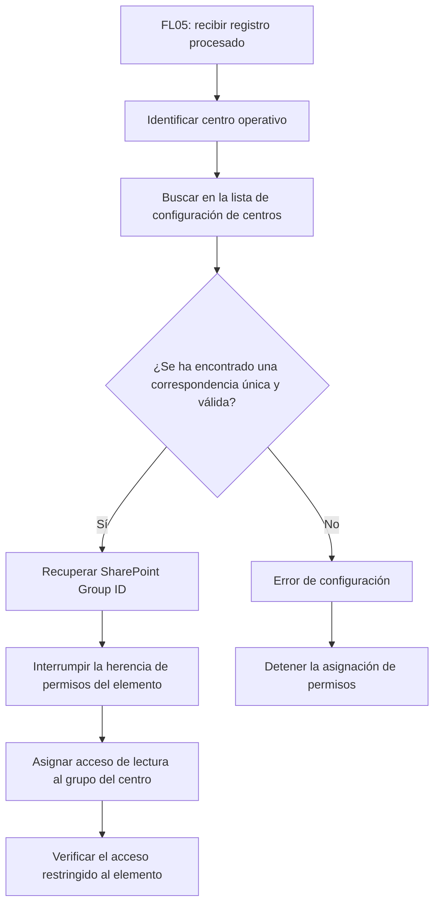

# Lista de configuración de centros

## 1. Descripción general

La lista de configuración de centros (*Centers Configuration List*) es una lista de SharePoint Online ubicada en el subsitio de gestión.

Proporciona una configuración centralizada que relaciona los centros operativos con los grupos de seguridad de SharePoint.

La lista permite gestionar automáticamente los permisos a nivel de elemento mediante Power Automate FL05.

También proporciona enlaces para que los administradores autorizados gestionen la pertenencia a los grupos de SharePoint.

> **Aviso sobre el portfolio:** Todos los nombres de centros, identificadores de grupos y URL utilizados en esta documentación son ficticios. No se incluye información de producción ni datos confidenciales.

## 2. Configuración de la lista

| Propiedad | Configuración |
|---|---|
| Nombre de la lista | Centers Configuration |
| Ubicación | Subsitio de gestión |
| Tipo de lista | Lista de SharePoint Online |
| Finalidad | Relación entre centros y grupos |
| Acceso | Lectura para todos los usuarios autorizados del subsitio |
| Integración con automatización | Power Automate FL05 |
| Administración de grupos | Enlaces de administración de grupos de SharePoint |

La solución utiliza una única lista de configuración, en lugar de listas independientes para la relación entre centros y grupos y para la administración de estos últimos.

## 3. Columnas de la lista

La lista de configuración contiene tres campos principales.

| Columna | Tipo sugerido | Descripción |
|---|---|---|
| Center | Una línea de texto | Nombre o identificador del centro operativo |
| SharePoint Group ID | Número | Identificador del grupo de SharePoint asociado al centro |
| Group Management Link | Hipervínculo | Enlace a la página de administración del grupo de SharePoint correspondiente |

Los nombres internos de los campos de SharePoint pueden ser distintos de los nombres visibles.

Se pueden incorporar columnas adicionales si la organización lo necesita.

## 4. Ejemplo de configuración

Los siguientes datos son ficticios.

| Centro | SharePoint Group ID | Enlace de administración del grupo |
|---|---|---|
| Centro Norte | 101 | URL de ejemplo para administrar el grupo |
| Centro Sur | 102 | URL de ejemplo para administrar el grupo |
| Centro Este | 103 | URL de ejemplo para administrar el grupo |

Los valores numéricos son únicamente identificadores de demostración.

Los identificadores reales de grupos de SharePoint y las URL administrativas deben configurarse en el entorno de destino.

## 5. Administración de grupos de SharePoint

Cada centro está asociado a un grupo de seguridad de SharePoint.

El campo `Group Management Link` ofrece un punto de acceso cómodo a la interfaz de administración del grupo correspondiente.

Los administradores de grupos autorizados pueden utilizar este enlace para gestionar sus miembros.

Los usuarios con acceso de solo lectura pueden ver el enlace, pero no administrar la pertenencia al grupo a menos que también dispongan de los permisos de SharePoint necesarios.

La administración de los grupos depende de la seguridad de SharePoint, no de la visibilidad del hipervínculo.

## 6. Permisos

Todos los usuarios con acceso al subsitio de gestión pueden leer la lista de configuración de centros.

| Rol | Permiso |
|---|---|
| Site Collection Administrators | Control administrativo |
| Site Owners | Lectura |
| Site Members | Lectura |
| Grupos de centros | Lectura |
| Personal externo | Sin acceso |

Los permisos de lectura documentados describen el acceso ordinario a la lista.

Los privilegios administrativos y los permisos autorizados para mantener la configuración deben gestionarse por separado.

## 7. Integración con FL05

La lista de configuración de centros proporciona la correspondencia entre los centros operativos y sus respectivos grupos de seguridad de SharePoint.

FL05 utiliza esta configuración para asignar dinámicamente permisos a nivel de elemento a los registros almacenados en la lista de registros procesados (*Processed Records List*).

### Proceso de búsqueda de configuración

1. FL05 recibe la información necesaria para identificar el registro procesado de SharePoint y su centro operativo asociado.
2. FL05 busca el centro correspondiente en la lista de configuración de centros.
3. El flujo recupera el `SharePoint Group ID` almacenado en el elemento de configuración coincidente.
4. FL05 utiliza el identificador del grupo recuperado para asignar permisos al registro procesado de SharePoint.
5. El grupo del centro asignado recibe acceso de **lectura** al registro correspondiente.
6. Los demás grupos de centros no deben acceder a registros de centros que no les correspondan.

### Responsabilidades de los componentes

| Componente | Responsabilidad |
|---|---|
| Centers Configuration List | Almacena las correspondencias entre centros y grupos |
| SharePoint Group ID | Identifica el grupo de seguridad asociado a un centro |
| Group Management Link | Proporciona acceso a la administración de grupos de SharePoint |
| FL05 | Aplica permisos dinámicos a nivel de elemento |
| Processed Records List | Almacena los registros protegidos mediante permisos basados en centros |

### Consideraciones importantes

La lista de configuración de centros es la referencia central para identificar los grupos de SharePoint específicos de cada centro.

FL05 debe comprobar que existe una configuración coincidente antes de intentar asignar permisos.

Las correspondencias ausentes, duplicadas o no válidas deben tratarse como errores de configuración y no pueden provocar accesos no deseados.

El campo `Group Management Link` facilita las tareas administrativas, pero no es necesario para la asignación automatizada de permisos.

La pertenencia a los grupos de SharePoint y el acceso efectivo siguen estando controlados por la seguridad de SharePoint.

## 8. Diagrama de asignación de permisos

El diagrama representa el proceso conceptual de asignación de permisos realizado por FL05.

El flujo identifica el centro operativo mediante la lista de configuración y recupera su correspondiente `SharePoint Group ID`.

Si la configuración no existe, está duplicada o no es válida, la asignación de permisos no debe continuar utilizando un grupo incorrecto.

Después de aplicar los permisos, debe comprobarse el acceso efectivo para garantizar que únicamente los usuarios autorizados puedan acceder al registro correspondiente.

Las acciones concretas de SharePoint, el tratamiento de errores y los niveles de permisos dependen de la implementación.

## 9. Mantenimiento de la configuración

Los administradores autorizados deben mantener actualizada la lista de configuración de centros para garantizar que FL05 utilice correspondencias válidas entre centros y grupos.

### Añadir un centro nuevo

1. Crear o identificar el grupo de seguridad de SharePoint correspondiente.
2. Configurar adecuadamente los miembros del grupo.
3. Añadir un elemento a la lista de configuración de centros.
4. Introducir el nombre del centro operativo.
5. Introducir el `SharePoint Group ID` correspondiente.
6. Añadir el `Group Management Link`.
7. Comprobar que la correspondencia es única y correcta.
8. Probar la asignación de permisos de FL05 con un registro de demostración.

### Modificar un centro existente

Cuando cambia el grupo de SharePoint asociado a un centro:

1. Revisar la configuración actual del centro.
2. Identificar el nuevo grupo de SharePoint y su ID.
3. Actualizar el elemento de configuración correspondiente.
4. Validar la nueva correspondencia.
5. Probar la asignación de permisos mediante FL05.
6. Revisar los registros procesados anteriormente que puedan conservar permisos asignados al grupo anterior.

Los cambios en la lista de configuración de centros afectan a las asignaciones futuras, pero **no actualizan automáticamente** los permisos ya aplicados a los registros existentes de SharePoint.

Es posible que los registros existentes requieran un proceso independiente de reasignación de permisos.

### Eliminar un centro

Antes de eliminar la configuración de un centro:

1. Identificar los registros existentes asociados al centro.
2. Revisar los permisos actualmente asignados a esos registros.
3. Determinar si los registros deben reasignarse, conservarse o archivarse.
4. Revisar el grupo de SharePoint correspondiente y sus miembros.
5. Eliminar o desactivar la configuración únicamente después de completar las actuaciones necesarias de control de acceso.

### Validación de la configuración

Los administradores deben comprobar periódicamente que:

- Cada centro operativo dispone de una entrada de configuración única.
- Los `SharePoint Group ID` corresponden a grupos válidos.
- Los enlaces `Group Management Link` dirigen a las páginas de administración previstas.
- Los miembros de los grupos de centros siguen siendo los adecuados.
- FL05 asigna permisos al grupo de SharePoint esperado.
- Los permisos asignados anteriormente siguen siendo coherentes con los requisitos actuales de la organización.

## 10. Consideraciones de seguridad

- Aplicar el principio de mínimo privilegio.
- Restringir la modificación de la configuración de centros a los administradores autorizados.
- Validar los `SharePoint Group ID` antes de utilizarlos.
- Evitar publicar URL de administración de grupos de producción en repositorios públicos.
- Revisar periódicamente los miembros de los grupos de centros.
- Verificar los permisos efectivos después de ejecutar FL05.
- Garantizar que acceder a un enlace de administración no otorgue privilegios administrativos por sí mismo.
- Tener en cuenta a los usuarios que pertenecen a varios grupos de centros.

## 11. Documentación relacionada

- [Subsitio de gestión](../sites/management-subsite.md)
- [Lista de registros procesados](processed-records.md)
- [Arquitectura de sitios de SharePoint](../architecture/sites-architecture.md)
- [Descripción general de SharePoint](../README.md)

## 12. Estado de la documentación

**Estado:** Documentación conceptual de la lista de configuración completada.

La estructura de la lista puede ampliarse según las necesidades de la organización.

Los identificadores reales de grupos de SharePoint y las URL de administración deben proporcionarse durante la implementación.

Este documento no es una plantilla automatizada para aprovisionar listas de SharePoint.
