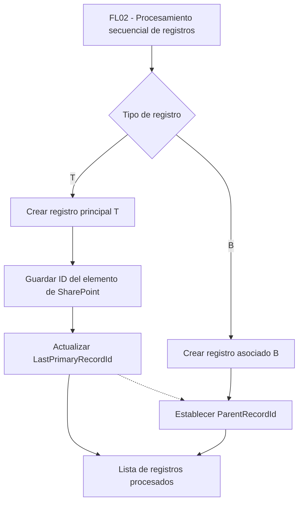

# Lista de registros procesados

## 1. Descripción general

La lista de registros procesados (*Processed Records List*) es una lista de SharePoint Online ubicada en el subsitio de gestión.

Almacena información estructurada extraída de libros de Excel validados mediante Power Automate.

La solución admite registros principales y asociados, relaciones entre registros y control de acceso basado en centros.

La lista está diseñada para adaptarse a diferentes requisitos empresariales y estructuras de datos de Excel.

> **Aviso sobre el portfolio:** Esta documentación describe una demostración conceptual con información ficticia. No contiene datos de producción, identificadores reales de grupos ni información empresarial confidencial.

## 2. Configuración de la lista

| Propiedad | Configuración |
|---|---|
| Nombre de la lista | Processed Records |
| Ubicación | Subsitio de gestión |
| Tipo de lista | Lista de SharePoint Online |
| Origen de datos | Libros de Excel validados |
| Creación de registros | Power Automate FL02 |
| Gestión de permisos | Power Automate FL05 |
| Estructura de datos | Configurable según los requisitos empresariales |

## 3. Estructura flexible de columnas

La lista de SharePoint está diseñada para incorporar la información extraída de los libros de Excel.

Se pueden crear columnas adicionales según los datos procesados y las necesidades de cada organización.

Por ejemplo, una implementación puede incluir:

- Identificadores de registros.
- Nombres o descripciones.
- Fechas.
- Valores numéricos.
- Categorías.
- Información de estado.
- Atributos adicionales específicos del negocio.

Son ejemplos, no campos obligatorios.

Cuando se necesiten campos nuevos, la solución puede ampliarse mediante estos pasos:

1. Añadir las columnas correspondientes a la lista de SharePoint.
2. Actualizar la lógica de extracción de Excel cuando sea necesario.
3. Actualizar la asignación de campos en FL02.
4. Probar el flujo de procesamiento con la estructura modificada.

Este enfoque permite reutilizar la solución en diferentes escenarios sin depender de un esquema empresarial fijo.

## 4. Tipos de registros

El flujo de procesamiento admite dos tipos de registros.

### 4.1 Registros principales (T)

Los registros principales representan las entidades principales extraídas del libro de Excel.

Cuando FL02 crea un registro principal, almacena el ID del elemento generado en SharePoint.

Este identificador se utiliza después para establecer relaciones con los registros asociados.

### 4.2 Registros asociados (B)

Los registros asociados contienen información vinculada a un registro principal.

Hacen referencia al elemento principal correspondiente de SharePoint mediante el campo `ParentRecordId`.

Esto permite almacenar la información relacionada en elementos independientes de la lista, conservando la relación entre los registros.

## 5. Relaciones entre registros

FL02 mantiene las relaciones entre registros principales (`T`) y asociados (`B`) durante el procesamiento secuencial de Excel.

El flujo procesa los registros con la concurrencia establecida en **1** para conservar el orden necesario para las relaciones entre elementos principales y asociados.

### Gestión de relaciones

1. FL02 lee los registros estructurados extraídos del libro de Excel validado.
2. El flujo procesa los registros secuencialmente.
3. Cuando identifica un registro principal (`T`), FL02 crea un elemento nuevo en la lista de registros procesados.
4. FL02 almacena el ID del elemento de SharePoint generado en la variable `LastPrimaryRecordId`.
5. Cuando identifica un registro asociado (`B`), FL02 crea un nuevo elemento en la lista.
6. El registro asociado recibe el valor de `LastPrimaryRecordId` en su campo `ParentRecordId`.
7. Así se establece la relación entre el registro asociado y su registro principal correspondiente.

### Diagrama de relaciones



### Consideraciones de procesamiento

La demostración presupone que cada registro principal aparece antes que sus registros asociados en los datos extraídos de Excel.

El procesamiento secuencial evita que las iteraciones concurrentes sobrescriban `LastPrimaryRecordId` mientras se crean los registros asociados.

El campo `ParentRecordId` almacena el ID del elemento de SharePoint correspondiente al registro principal.

La estrategia de relaciones puede adaptarse si la estructura del Excel de origen requiere un orden de procesamiento diferente.

## 6. Identificación de familias

La solución utiliza un identificador compuesto de familia para distinguir grupos de registros relacionados procedentes de diferentes archivos Excel.

El identificador se genera mediante esta expresión:

```text
concat(SourceFileId, '-', ReferenceCode)
```

`SourceFileId` identifica el documento Excel de origen, mientras que `ReferenceCode` identifica la familia o el grupo de registros relacionados dentro de ese documento.

Esta combinación ayuda a evitar colisiones de identificadores entre registros procedentes de diferentes archivos de origen.

Durante el procesamiento secuencial, FL02 almacena el `ReferenceCode` del último registro principal (`T`) creado correctamente en la variable `LastPrimaryReferenceCode`.

Un registro asociado (`B`) solo puede crearse cuando se cumplen ambas condiciones:

1. `LastPrimaryRecordId` es mayor que cero.
2. Su `ReferenceCode` coincide con `LastPrimaryReferenceCode`.

Si alguna condición no se cumple, FL02 omite la creación del registro asociado y añade una entrada de diagnóstico.

Esto evita vincular registros asociados a un registro principal ajeno o cuya creación haya fallado.

## 7. Clasificación por centros

Cada registro procesado está asociado a un centro operativo.

La información del centro se utiliza para determinar qué grupo de SharePoint debe recibir acceso al registro.

La relación entre los centros y los grupos de SharePoint se mantiene en la lista de configuración de centros (*Centers Configuration List*).

Esto permite separar los datos empresariales de la configuración del control de acceso.

## 8. Permisos a nivel de elemento

La lista de registros procesados utiliza permisos a nivel de elemento para restringir el acceso según el centro operativo asociado a cada registro.

FL05 se encarga de aplicar estos permisos dinámicamente.

### Proceso de asignación de permisos

1. FL02 crea un elemento nuevo en la lista de registros procesados.
2. FL05 recibe la información necesaria para identificar el registro y su centro asociado.
3. FL05 busca el centro en la lista de configuración de centros.
4. La lista de configuración proporciona el ID del grupo de SharePoint asociado a ese centro.
5. FL05 interrumpe la herencia de permisos del elemento correspondiente.
6. FL05 asigna los permisos necesarios al grupo del centro autorizado.
7. Los permisos resultantes restringen el acceso al centro correspondiente.

### Modelo de permisos

| Rol | Acceso |
|---|---|
| Administradores de la colección de sitios | Control administrativo |
| Site Owners | Acceso según el modelo de seguridad configurado |
| Site Members | Acceso según el modelo de seguridad configurado |
| Grupo del centro asignado | Lectura |
| Otros grupos de centros | Sin acceso |
| Personal externo | Sin acceso |

### Consideraciones de seguridad

Cada grupo de centro solo debe poder acceder a los registros asignados a su centro correspondiente.

El acceso general de lectura al subsitio de gestión no concede automáticamente acceso a todos los elementos de la lista de registros procesados cuando se ha interrumpido correctamente la herencia de permisos y estos se han configurado de forma adecuada.

La lista de configuración de centros proporciona la relación entre los centros operativos y los identificadores de los grupos de SharePoint.

FL05 debe utilizar una conexión con autorización suficiente para gestionar los permisos de los elementos de SharePoint.

Deben comprobarse los permisos efectivos para garantizar que los usuarios no puedan acceder a registros de otros centros mediante permisos heredados, pertenencia a otros grupos o asignaciones directas.

## 9. Integración con Power Automate

La lista de registros procesados se integra con tres flujos de Power Automate: FL02, FL05 y FL04.

### FL02: procesamiento de Excel

FL02 se encarga de:

- Leer y procesar datos de Excel validados.
- Identificar registros principales (`T`) y asociados (`B`).
- Crear elementos en la lista de SharePoint.
- Mantener las relaciones entre registros mediante `LastPrimaryRecordId` y `ParentRecordId`.
- Asociar cada registro con su centro operativo correspondiente.
- Registrar los resultados del procesamiento y los errores.

FL02 procesa los registros secuencialmente para conservar la relación entre registros principales y asociados.

### FL05: permisos dinámicos por elemento

FL05 se encarga de:

- Recibir la información necesaria para identificar el registro de SharePoint y su centro operativo.
- Buscar el ID del grupo de SharePoint del centro en la lista de configuración de centros.
- Interrumpir la herencia de permisos del elemento.
- Asignar permisos de lectura al grupo del centro correspondiente.
- Restringir el acceso de los demás grupos de centros.

FL05 aplica las reglas de control de acceso de manera independiente de la lógica de creación de registros.

### FL04: registros de ejecución

FL04 registra los resultados del procesamiento y la información de diagnóstico en la lista de registros de ejecución (*Processing Logs List*).

Esto proporciona trazabilidad de la ejecución de FL02, incluidos los registros creados y los errores de procesamiento.

### Responsabilidades de los flujos

| Flujo | Responsabilidad |
|---|---|
| FL02 | Procesamiento de Excel y creación de registros en SharePoint |
| FL05 | Asignación dinámica de permisos a nivel de elemento |
| FL04 | Registro de resultados y trazabilidad de las ejecuciones |

Separar estas responsabilidades facilita el mantenimiento y permite evolucionar de forma independiente la lógica de procesamiento y la de permisos.

## 10. Datos de ejemplo

El siguiente ejemplo es ficticio e ilustra la relación entre los registros.

| ID del elemento | Tipo de registro | Descripción | ParentRecordId | Centro |
|---|---|---|---|---|
| 101 | T | Registro principal A | | Centro Norte |
| 102 | B | Registro asociado A1 | 101 | Centro Norte |
| 103 | B | Registro asociado A2 | 101 | Centro Norte |
| 104 | T | Registro principal B | | Centro Sur |
| 105 | B | Registro asociado B1 | 104 | Centro Sur |

El ejemplo no define un esquema obligatorio de SharePoint.

Se pueden añadir campos adicionales para admitir diferentes plantillas de Excel y requisitos de procesamiento.

## 11. Consideraciones de seguridad

- Aplicar permisos basados en el principio de mínimo privilegio.
- Restringir el acceso mediante permisos de SharePoint a nivel de elemento.
- Utilizar la lista de configuración de centros para determinar las asignaciones de grupos.
- Evitar que se expongan registros de centros no relacionados.
- Revisar los permisos efectivos de los usuarios que pertenecen a varios grupos.
- Validar la herencia de permisos y las asignaciones de acceso.
- No almacenar identificadores reales de grupos ni información confidencial en los ejemplos públicos.

## 12. Documentación relacionada

- [Subsitio de gestión](../sites/management-subsite.md)
- [Arquitectura de sitios de SharePoint](../architecture/sites-architecture.md)
- [Descripción general de SharePoint](../README.md)

## 13. Estado de la documentación

**Estado:** Documentación conceptual de la lista completada.

El esquema de columnas de SharePoint puede ampliarse según la estructura de los datos Excel de origen y los requisitos empresariales.

Los scripts detallados de aprovisionamiento y las asignaciones de campos específicas de producción se excluyen deliberadamente de este ejemplo de portfolio.

Este documento no es una plantilla de aprovisionamiento automatizado de listas de SharePoint.
