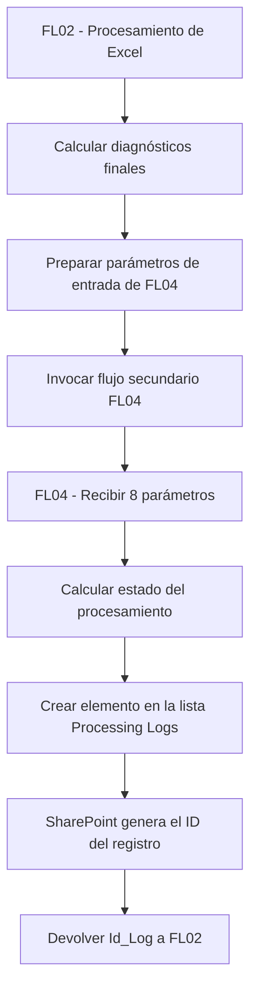

# Lista de registros de ejecución

## 1. Descripción general

La lista de registros de ejecución (*Processing Logs List*) es una lista de SharePoint Online ubicada en el subsitio de gestión.

Proporciona un registro centralizado y trazabilidad de las operaciones automatizadas de procesamiento documental.

Power Automate FL04 alimenta la lista con la información de ejecución recibida del flujo de procesamiento.

Permite la supervisión operativa, el diagnóstico de incidencias y el análisis histórico.

> **Aviso sobre el portfolio:** Esta documentación describe una demostración conceptual con información ficticia. No incluye direcciones URL de producción, credenciales, identificadores reales ni datos empresariales confidenciales.

## 2. Configuración de la lista

| Propiedad | Configuración |
|---|---|
| Nombre de la lista | Processing Logs |
| Ubicación | Subsitio de gestión |
| Tipo de lista | Lista de SharePoint Online |
| Finalidad | Registro y trazabilidad de ejecuciones |
| Creación de registros | Power Automate FL04 |
| Acceso de usuarios | Solo lectura para Site Owners y Site Members |
| Grupos de centros | Sin acceso |
| Esquema | Adaptable a los requisitos de implementación |

## 3. Información registrada

La lista almacena información sobre cada ejecución de procesamiento de Excel.

El siguiente esquema conceptual se corresponde con los campos definidos en `FL04-demo.json`.

### Esquema de columnas de SharePoint

| Nombre para mostrar | Nombre interno | Tipo | Descripción |
|---|---|---|---|
| Referencia de procesamiento | ProcessingReferenceId | Número | Identificador de referencia de la operación de procesamiento |
| ID del archivo de origen | SourceFileId | Número | Identificador del archivo de origen en SharePoint |
| ID de ejecución | ExecutionId | Una línea de texto | Identificador de ejecución de Power Automate |
| Fecha de ejecución | ExecutionDate | Fecha y hora | Marca temporal UTC generada por FL04 |
| Registros leídos | RecordsRead | Número | Total de registros extraídos de Excel |
| Registros creados | RecordsCreated | Número | Registros creados correctamente en SharePoint |
| Registros con errores | RecordsWithErrors | Número | Operaciones fallidas de creación de registros en SharePoint |
| Estado del procesamiento | Status | Opción | Estado de ejecución calculado |
| Detalles de errores | ErrorDetails | Varias líneas de texto | Detalles consolidados de los errores de creación en SharePoint |

### Valores del estado de procesamiento

La columna `Status` utiliza los siguientes valores de opción conceptuales:

| Valor | Significado |
|---|---|
| `Success` | Registros creados sin errores de creación en SharePoint notificados |
| `Partial Success` | Registros creados con uno o varios errores de creación en SharePoint |
| `Error` | Ningún registro creado y al menos un error de creación en SharePoint |
| `No Records` | Ningún registro creado y ningún error de creación en SharePoint notificado |

Estos valores coinciden con la lógica de estados definida en FL04.

### Alcance del recuento de errores

`RecordsWithErrors` representa las operaciones fallidas de creación de registros en SharePoint.

En la demostración de FL02:

```text
RecordsWithErrors = SharePointErrors
```

Los errores de validación de Excel, los tipos de registro no admitidos y los fallos a nivel de flujo no se incluyen en este contador.

Por tanto, el estado `No Records` no indica necesariamente que todo el flujo haya finalizado correctamente.

### Correspondencia de campos

FL04 crea un elemento de lista de SharePoint con las siguientes correspondencias:

| Nombre interno de SharePoint | Valor de FL04 |
|---|---|
| ProcessingReferenceId | inputs.ProcessingReferenceId |
| SourceFileId | inputs.SourceFileId |
| ExecutionId | inputs.ExecutionId |
| ExecutionDate | utcNow() |
| RecordsRead | inputs.RecordsRead |
| RecordsCreated | inputs.RecordsCreated |
| RecordsWithErrors | inputs.RecordsWithErrors |
| Status | CalculatedProcessingStatus |
| ErrorDetails | inputs.ErrorDetails |

El ID del elemento de SharePoint se genera automáticamente cuando FL04 crea el registro.

FL04 devuelve este ID a FL02 mediante el parámetro de salida `Id_Log`.

### Consideraciones de implementación

Este es un esquema conceptual de SharePoint, no una definición automatizada para aprovisionar la lista.

Los nombres internos de las columnas deben configurarse de forma coherente en el entorno de SharePoint de destino.

La columna estándar `Title` de SharePoint también debe configurarse adecuadamente si sigue siendo obligatoria.

La entrada `SourceFileName` está disponible en FL04, pero actualmente no se guarda en el esquema de lista mostrado.

En futuras versiones pueden incorporarse campos adicionales, como un resumen del procesamiento, si se asignan explícitamente en FL04.

## 4. Integración con FL04

FL04 es un flujo secundario de Power Automate encargado de crear entradas de ejecución en la lista Processing Logs.

FL02 lo invoca después de preparar los resultados del procesamiento y la información de diagnóstico.

### Información recibida de FL02

FL02 envía la información necesaria para documentar la ejecución del procesamiento.

La información conceptual de registro incluye:

- Identificador de ejecución del procesamiento.
- Referencia del documento de origen.
- Estado del procesamiento.
- Número de registros creados correctamente.
- Número de errores de SharePoint.
- Detalles de los errores.
- Resumen del procesamiento.
- Fecha y hora de ejecución.

El flujo de demostración utiliza ocho parámetros de entrada. Sus nombres y tipos de datos exactos se definen en la documentación de FL04.

### Proceso de creación del registro

1. FL02 prepara el resumen del procesamiento y la información de diagnóstico.
2. FL02 invoca el flujo secundario FL04.
3. FL04 recibe la información del procesamiento.
4. FL04 crea un nuevo elemento en la lista Processing Logs.
5. SharePoint genera un ID único para el registro de ejecución.
6. FL04 devuelve a FL02 el ID del elemento creado mediante el parámetro de salida `Id_Log`.
7. FL02 puede utilizar `Id_Log` en operaciones posteriores de diagnóstico y seguimiento.

### Responsabilidades de los flujos

| Componente | Responsabilidad |
|---|---|
| FL02 | Procesa los datos de Excel y prepara los resultados de ejecución |
| FL04 | Crea la entrada de registro del procesamiento en SharePoint |
| Lista Processing Logs | Almacena el historial de ejecuciones y la información de diagnóstico |

### Consideraciones importantes

FL04 debe utilizar una conexión de SharePoint con los permisos necesarios para crear entradas.

El valor devuelto en `Id_Log` identifica el elemento correspondiente de la lista de registros.

El mecanismo de registro permite trazar ejecuciones correctas, parcialmente correctas y fallidas, según las rutas de ejecución que invoquen FL04.

Los campos exactos del registro pueden adaptarse a los requisitos de cada implementación.

## 5. Flujo de registro de ejecuciones



El diagrama ilustra el proceso conceptual de registro entre FL02 y FL04.

FL02 prepara los resultados del procesamiento e invoca FL04 con la información requerida.

FL04 crea un elemento de SharePoint en la lista Processing Logs y devuelve su identificador mediante el parámetro de salida `Id_Log`.

FL02 recibe el identificador y puede utilizarlo en operaciones posteriores de diagnóstico o seguimiento.

Los parámetros exactos de entrada, la configuración de salida y la gestión de errores se definen en la documentación correspondiente del flujo de Power Automate.

## 6. Seguimiento de errores

El mecanismo de registro permite almacenar errores de procesamiento.

Según la implementación, la información de errores puede incluir:

- Operaciones fallidas de SharePoint.
- Descripciones de errores.
- Referencias a registros afectados.
- Identificadores de ejecución del procesamiento.
- Resultados de procesamiento parciales.

Los detalles de los errores deben estructurarse para facilitar el diagnóstico sin exponer información sensible innecesariamente.

Una ejecución puede crear algunos registros correctamente y, al mismo tiempo, presentar errores.

Por tanto, el registro debe distinguir entre resultados correctos, parcialmente correctos y fallidos cuando el flujo lo permita.

## 7. Ejemplos de registros de ejecución

Los siguientes ejemplos utilizan información ficticia y siguen el modelo de estados de FL04.

| ID de ejecución | Estado del procesamiento | Registros creados | Registros con errores |
|---|---|---|---|
| DEMO-001 | Success | 25 | 0 |
| DEMO-002 | Partial Success | 18 | 2 |
| DEMO-003 | Error | 0 | 1 |
| DEMO-004 | No Records | 0 | 0 |

La columna «Estado del procesamiento» corresponde al campo interno de SharePoint `Status`.

La columna «Registros con errores» corresponde al campo interno `RecordsWithErrors`.

En esta demostración, los errores contabilizan únicamente operaciones fallidas de creación de registros en SharePoint.

Los ejemplos ilustran los cuatro valores de estado definidos en FL04.

## 8. Permisos

La lista Processing Logs está restringida a los usuarios autorizados de gestión.

| Rol | Permiso |
|---|---|
| Site Collection Administrators | Control administrativo |
| Site Owners | Lectura |
| Site Members | Lectura |
| Grupos de centros | Sin acceso |
| Personal externo | Sin acceso |

Dado que los grupos de centros tienen acceso general de lectura al subsitio de gestión, la lista Processing Logs debe tener permisos restringidos adecuadamente.

Se interrumpe la herencia de permisos cuando sea necesario para impedir accesos no autorizados.

## 9. Acceso de escritura automatizado

FL04 crea registros de ejecución mediante una conexión autorizada de Power Automate.

Aunque los usuarios ordinarios de Site Owners y Site Members tengan acceso de solo lectura, la conexión de automatización debe disponer de permisos suficientes para crear elementos de lista.

Esto separa la creación operativa de registros del acceso humano al historial.

La identidad de la conexión y sus permisos deben configurarse en el entorno de destino.

## 10. Supervisión y diagnóstico

La lista Processing Logs puede utilizarse para:

1. Revisar ejecuciones de procesamiento anteriores.
2. Identificar ejecuciones con errores.
3. Comparar el número de registros creados.
4. Localizar referencias a documentos de origen.
5. Investigar fallos de procesamiento.
6. Supervisar problemas recurrentes.

Pueden configurarse vistas de SharePoint para filtrar o agrupar las entradas por fecha, estado u otros campos disponibles.

También pueden integrarse soluciones adicionales de supervisión si es necesario.

## 11. Retención de datos y seguridad

La información de registro debe gestionarse de acuerdo con los requisitos de la organización.

Entre las consideraciones recomendadas se incluyen:

- Definir un período de conservación de registros.
- Restringir el acceso al personal autorizado.
- Evitar almacenar datos personales innecesarios.
- Limitar la información sensible incluida en los mensajes de error.
- Revisar los permisos de las conexiones de automatización.
- Supervisar el crecimiento del historial de registros.
- Establecer un procedimiento para investigar las ejecuciones fallidas.

La demostración conceptual no establece una política de retención obligatoria.

## 12. Documentación relacionada

- [Subsitio de gestión](../sites/management-subsite.md)
- [Arquitectura de sitios de SharePoint](../architecture/sites-architecture.md)
- [Descripción general de SharePoint](../README.md)

## 13. Estado de la documentación

**Estado:** Documentación conceptual de la lista de registros de ejecución completada.

El esquema de la lista puede ampliarse según las necesidades de supervisión operativa.

Las columnas exactas de SharePoint, las asignaciones de permisos y los ajustes de retención deben configurarse en el entorno de destino.

Este documento no es una plantilla automatizada para aprovisionar listas de SharePoint.
