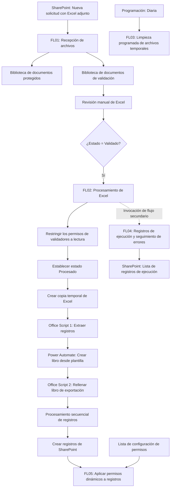

# Arquitectura de la solución

## Descripción general

Este proyecto muestra un proceso automatizado de tratamiento de archivos Excel mediante Microsoft Power Platform, SharePoint Online y Office Scripts.

La solución combina validación manual, transformación automatizada de datos, creación de registros de SharePoint y gestión dinámica de permisos.

## Diagrama de arquitectura

## Componentes principales

### FL01: Recepción de archivos

Recibe solicitudes con archivos Excel adjuntos y crea copias en dos bibliotecas de documentos de SharePoint:

- Biblioteca protegida para acceso administrativo.
- Biblioteca de validación para revisores autorizados.

### FL02: Procesamiento de Excel

Se desencadena cuando un archivo se marca como validado.

El flujo restringe los permisos de edición, actualiza el estado de procesamiento, extrae datos de Excel, genera archivos de salida y crea registros relacionados de SharePoint.

Los registros principales y asociados se procesan secuencialmente para conservar sus relaciones.

### FL03: Limpieza de archivos temporales

Flujo programado que elimina archivos temporales de procesamiento con más de ocho horas de antigüedad.

### FL04: Registros de ejecución y seguimiento de errores

Flujo secundario reutilizable, invocado por FL02, que centraliza los registros de procesamiento y la notificación de errores.

Recibe información de ejecución, como el archivo de origen, la referencia de procesamiento, los recuentos de registros, los detalles de los errores y el identificador de ejecución.

Crea una entrada en una lista de SharePoint para proporcionar trazabilidad y facilitar la resolución de incidencias.

Esta separación permite que el flujo principal se centre en las operaciones de negocio y delegue los registros de ejecución en un componente específico.

### FL05: Permisos dinámicos

Se desencadena cuando se crea un registro de SharePoint.

Utiliza una lista de configuración para determinar los grupos de seguridad correspondientes y aplica permisos a nivel de registro.

## Seguridad

Esta arquitectura representa una demostración independiente con datos ficticios y configuraciones genéricas.

No incluye componentes corporativos propietarios, credenciales ni configuraciones internas.
