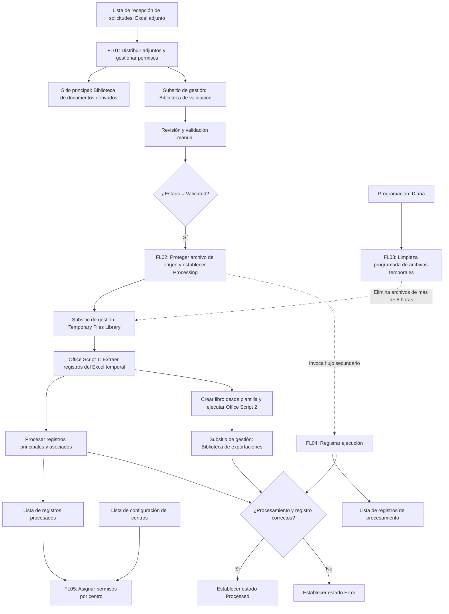

# Arquitectura de la solución

## Descripción general

Este proyecto muestra un proceso automatizado de tratamiento de archivos Excel mediante Microsoft Power Platform, SharePoint Online y Office Scripts.

La solución combina recepción de solicitudes, validación manual, transformación automatizada de datos, creación de registros de SharePoint, exportación y gestión dinámica de permisos.

La arquitectura contempla un **sitio principal** y un **subsitio de gestión**, con **cuatro bibliotecas documentales** de responsabilidades diferenciadas.

## Diagrama de arquitectura

El diagrama resume las responsabilidades conceptuales. El orden pormenorizado de acciones y las condiciones de error se describen en la [documentación de FL02](../flows/FL02-demo/README.md).

## Distribución de las bibliotecas

| Ubicación | Biblioteca | Función |
|---|---|---|
| Sitio principal | Biblioteca de documentos derivados | Conservar las copias distribuidas por FL01. |
| Subsitio de gestión | Biblioteca de validación | Alojar los documentos de origen sujetos a revisión y procesamiento por FL02. |
| Subsitio de gestión | `Temporary Files Library` | Alojar las copias de trabajo de Excel utilizadas por FL02 y limpiadas por FL03. |
| Subsitio de gestión | Biblioteca de exportaciones | Conservar los libros de resultados generados durante FL02. |

Estas cuatro bibliotecas son recursos independientes. En particular, **FL03 solo actúa sobre `Temporary Files Library`** y no debe eliminar documentos de validación, documentos derivados ni exportaciones.

Consulta la [arquitectura detallada de sitios](../Sharepoint/architecture/sites-architecture.md) y la [documentación de la biblioteca temporal](../Sharepoint/libraries/temporary-files-library.md).

## Componentes principales

### FL01: Recepción de archivos

Recibe solicitudes con archivos Excel adjuntos y crea copias en dos bibliotecas: documentos derivados del sitio principal y validación del subsitio de gestión. También aplica los permisos previstos a las solicitudes.

### FL02: Procesamiento de Excel

Se desencadena cuando un archivo de la biblioteca de validación tiene el estado `Validated`. Protege el documento de origen, interrumpe su herencia de permisos según el modelo documentado y establece el estado `Processing` antes de las operaciones sobre Excel.

FL02 crea una copia de trabajo en `Temporary Files Library`, utiliza Office Scripts para extraer datos y cumplimentar el libro de exportación, y crea registros relacionados en SharePoint. Los registros principales y asociados se procesan secuencialmente para conservar sus relaciones.

El documento de origen solo pasa a `Processed` cuando el procesamiento y el registro de ejecución finalizan correctamente y no hay errores de creación de registros. Si no se cumplen esas condiciones, se contempla el estado `Error`.

### FL03: Limpieza de archivos temporales

Flujo programado que elimina archivos de `Temporary Files Library` con más de ocho horas de antigüedad. Es independiente de FL02 y no modifica los documentos originales ni los libros de exportación.

### FL04: Registros de ejecución y seguimiento de errores

Flujo secundario reutilizable, invocado por FL02, que centraliza los registros de procesamiento y el diagnóstico de errores.

Recibe información de ejecución, como el archivo de origen, la referencia de procesamiento, los recuentos de registros, los detalles de los errores y el identificador de ejecución.

Crea una entrada en la lista de registros de procesamiento de SharePoint para proporcionar trazabilidad y facilitar la resolución de incidencias.

### FL05: Permisos dinámicos

Se desencadena cuando se crea un registro de SharePoint.

Utiliza la lista de configuración de centros para determinar los grupos correspondientes y aplica permisos a nivel de registro, de modo que cada centro acceda únicamente a los registros que le corresponden según el modelo documentado.

## Estados documentales

El ciclo de vida de la biblioteca de validación contempla `Pending Validation`, `Validated`, `Processing`, `Processed` y `Error`.

FL02 interviene desde `Validated` y utiliza `Processing` durante el trabajo. `Processed` y `Error` son estados finales del documento para la ejecución considerada. Los estados de ejecución registrados mediante FL04 son diferentes y no sustituyen los estados documentales.

## Seguridad

Esta arquitectura representa una demostración independiente con datos ficticios y configuraciones genéricas.

Los permisos de las bibliotecas, de los documentos de origen y de los registros procesados se gestionan de forma diferenciada. Las conexiones de automatización deben disponer de los permisos necesarios, sin ampliar innecesariamente los permisos de los usuarios.

No incluye componentes corporativos propietarios, credenciales ni configuraciones internas.
