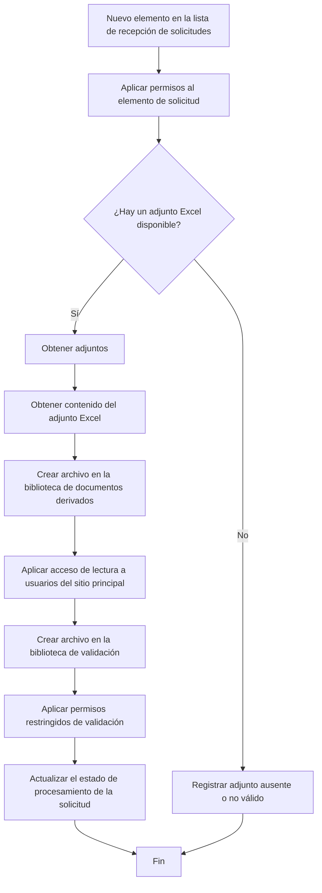

# FL01 - Recepción y distribución de archivos en SharePoint

## Descripción general

Demostración de un flujo de Power Automate diseñado para recibir archivos Excel adjuntos a elementos de una lista de SharePoint y distribuirlos a dos bibliotecas documentales.

Todos los nombres, identificadores y datos son ficticios.

## Arquitectura

### Diagrama del flujo

**Desencadenador:** SharePoint, cuando se crea un elemento en la lista de recepción de solicitudes (*Request Intake List*).

**Proceso:**

1. Detectar una nueva solicitud enviada a través de la lista de recepción de solicitudes de SharePoint.
2. Aplicar permisos a nivel de elemento a la solicitud presentada.
3. Recuperar los archivos adjuntos de la solicitud.
4. Identificar y recuperar el libro de Excel (`.xlsx`).
5. Crear una copia en la biblioteca de documentos derivados (*Derived Documents Library*) del sitio principal.
6. Garantizar el acceso de lectura a dicha biblioteca para todos los usuarios autorizados del sitio principal.
7. Crear una segunda copia en la biblioteca de validación (*Validation Library*) del subsitio de gestión.
8. Aplicar el modelo de permisos restringidos necesario para la validación interna.
9. Actualizar el estado de procesamiento y los metadatos relevantes de la solicitud.
10. Finalizar el flujo.

## Componentes de SharePoint

FL01 se inicia cuando se crea una nueva solicitud en la lista de recepción de solicitudes de SharePoint.

Cada solicitud es un elemento de lista que contiene observaciones y un libro de Excel adjunto.

El flujo recupera los adjuntos y crea copias documentales en dos bibliotecas de SharePoint.

| Componente | Ubicación | Finalidad |
|---|---|---|
| Lista de recepción de solicitudes (*Request Intake List*) | Sitio principal | Almacena solicitudes, observaciones y archivos Excel adjuntos. |
| Biblioteca de documentos derivados (*Derived Documents Library*) | Sitio principal | Almacena copias de documentos generadas a partir de solicitudes. Todos los usuarios autorizados del sitio tienen acceso de lectura. |
| Biblioteca de validación (*Validation Library*) | Subsitio de gestión | Almacena copias Excel para validación interna y posterior procesamiento. Acceso restringido a usuarios de gestión autorizados. |

La lista de recepción de solicitudes es el punto de entrada del proceso. **No es una biblioteca documental**.

La biblioteca de documentos derivados proporciona acceso de solo lectura a los documentos para todos los usuarios autorizados del sitio principal.

La biblioteca de validación se encuentra en el subsitio de gestión y sigue un modelo de permisos independiente y restringido.

## Permisos

FL01 utiliza modelos de permisos diferentes para el elemento de solicitud y para las copias documentales creadas durante el procesamiento.

| Recurso de SharePoint | Personal externo | Miembros del sitio | Propietarios del sitio |
|---|---|---|---|
| Lista de recepción de solicitudes | Crear solicitudes y leer elementos autorizados | Lectura | Lectura |
| Biblioteca de documentos derivados | Lectura | Lectura | Lectura |
| Biblioteca de validación | Sin acceso | Edición durante la validación | Edición durante la validación |

### Lista de recepción de solicitudes

El personal externo presenta solicitudes mediante elementos de lista de SharePoint que contienen observaciones y archivos Excel adjuntos.

FL01 aplica permisos a nivel de elemento para controlar el acceso a las solicitudes presentadas.

### Biblioteca de documentos derivados

La biblioteca está ubicada en el sitio principal.

Todos los usuarios autorizados del sitio principal tienen acceso de lectura a los documentos.

El flujo utiliza una conexión de servicio autorizada para crear y gestionar las copias documentales.

### Biblioteca de validación

La biblioteca está ubicada en el subsitio de gestión.

El personal externo y los grupos de centros no tienen acceso.

Los usuarios de gestión autorizados pueden modificar los documentos durante la etapa de validación.

Una vez que FL02 procesa un documento validado, aplica permisos de solo lectura a los miembros y propietarios del sitio. Los administradores de la colección de sitios conservan sus capacidades administrativas de modificación.

### Consideraciones de seguridad

- Los permisos de SharePoint hacen efectivas las restricciones de acceso.
- Las personalizaciones de interfaz mediante JSON no sustituyen a los permisos de seguridad.
- Las conexiones de automatización necesitan permisos adecuados para crear archivos y actualizar accesos.
- Los administradores de la colección de sitios conservan el control administrativo.
- El modelo de permisos debe probarse en un entorno de demostración antes de utilizarse en producción.

## Estado de implementación

**Demostración conceptual. No es un flujo importable directamente en Power Automate.**

El archivo [FL01-demo.json](FL01-demo.json) documenta la arquitectura prevista del flujo.

Los permisos de SharePoint, las actualizaciones de metadatos y el tratamiento de adjuntos deben implementarse y probarse en un entorno adecuado.

## Seguridad

- Recursos de SharePoint ficticios.
- Sin datos reales de usuarios.
- Sin credenciales ni identificadores de conexión.
- Sin exportaciones de soluciones corporativas.

## Aspectos técnicos destacados

Este flujo conceptual demuestra el diseño de un proceso de automatización documental basado en SharePoint y Microsoft Power Automate.

### Gestión de permisos de SharePoint

- Romper la herencia de permisos en los elementos de la lista de solicitudes para controlar el acceso a cada solicitud.
- Conceder acceso de lectura a la persona creadora de la solicitud, a los miembros del sitio y a los propietarios del sitio.
- Proporcionar acceso de solo lectura a la biblioteca de documentos derivados para todos los usuarios autorizados del sitio principal.
- Restringir el acceso a la biblioteca de validación a los usuarios de gestión autorizados.
- Permitir que los miembros y propietarios del sitio editen documentos durante la etapa de validación.
- Admitir los cambios de permisos de FL02 tras el procesamiento, dejando los documentos validados en modo de solo lectura para miembros y propietarios del sitio.
- Preservar el control administrativo de los administradores de la colección de sitios.
- Utilizar permisos de SharePoint para aplicar restricciones de acceso con independencia de las personalizaciones de interfaz JSON.

### Automatización documental

- Activar un flujo cuando se crea un elemento en una lista de SharePoint.
- Recuperar archivos adjuntos y su contenido.
- Crear documentos en bibliotecas de SharePoint distintas.
- Dar soporte a un proceso de validación documental.

### Metadatos y seguimiento del proceso

- Actualizar propiedades de elementos de listas de SharePoint.
- Recuperar y actualizar metadatos documentales.
- Registrar información de procesamiento en diferentes etapas.
- Mantener la trazabilidad entre las solicitudes y los documentos relacionados.

### Arquitectura y documentación

- Documentar la arquitectura del flujo mediante diagramas Mermaid.
- Describir los componentes del flujo mediante JSON estructurado.
- Separar el diseño conceptual de las definiciones ejecutables de Power Automate.
- Utilizar recursos ficticios para mostrar conceptos técnicos sin exponer información corporativa.

**Nota de implementación:** Este repositorio contiene una demostración conceptual. El flujo no se ha desplegado ni probado como solución ejecutable en el entorno de demostración.

## Tecnologías

- Microsoft Power Automate
- SharePoint Online
- JSON
