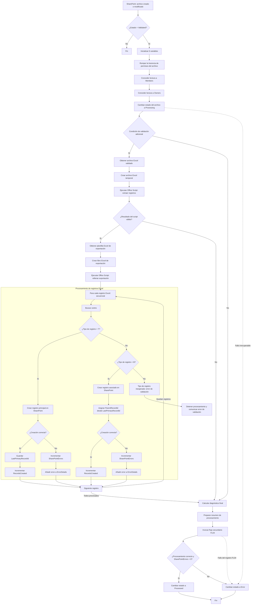
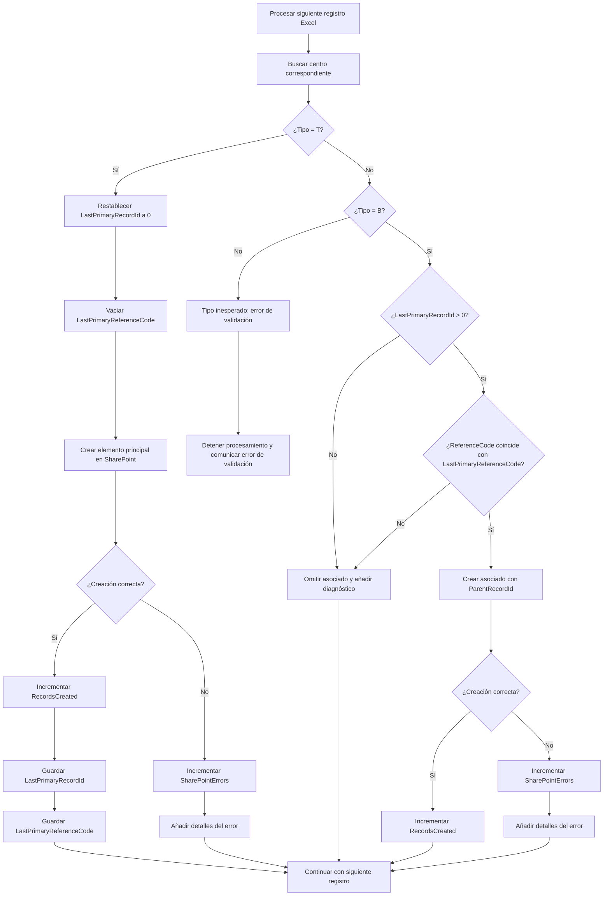

# FL02 - Procesamiento de Excel y creación de registros

## Descripción general

FL02 es el flujo principal de Power Automate encargado de procesar archivos Excel validados, generar libros de salida y crear registros relacionados en SharePoint Online.

Orquesta la gestión documental en SharePoint, la ejecución de Office Scripts, el procesamiento secuencial de registros, el seguimiento de errores y el registro de ejecuciones mediante el flujo secundario FL04.

Se trata de una demostración conceptual independiente con datos ficticios.

## Arquitectura



El diagrama representa el procesamiento conceptual. El archivo de origen se marca como `Processing` antes de las operaciones con Excel. Tras procesar y registrar la ejecución, el flujo determina si debe quedar como `Processed` o `Error`.

Las flechas discontinuas representan rutas conceptuales de excepción; **no implican un tratamiento de errores ejecutable** en Power Automate.

## Desencadenador

**SharePoint: Cuando se crea o modifica un archivo (solo propiedades).**

El flujo utiliza una condición de desencadenador que comprueba si el estado del archivo es `Validated`. Antes del procesamiento principal se aplica otra condición de validación.

Al cambiar el estado a `Processing`, las modificaciones posteriores dejan de cumplir la condición `Validated`, lo que ayuda a evitar ejecuciones duplicadas.

## Inicialización

El flujo inicializa seis variables:

| Variable | Tipo | Finalidad |
|---|---|---|
| `SharePointErrors` | Integer | Cuenta los errores de creación de registros en SharePoint. |
| `RecordsWithErrors` | Integer | Almacena el número final de registros cuya creación falló. |
| `LastPrimaryRecordId` | Integer | Guarda el ID del último registro principal creado correctamente. |
| `LastPrimaryReferenceCode` | String | Guarda el `ReferenceCode` del último registro principal creado correctamente. |
| `ErrorDetails` | Array | Recopila los detalles de errores de creación. |
| `RecordsCreated` | Integer | Cuenta los registros creados correctamente. |

### Seguimiento del registro principal

Al procesar un nuevo registro principal (`T`):

1. Restablecer `LastPrimaryRecordId` a `0`.
2. Vaciar `LastPrimaryReferenceCode`.
3. Intentar crear el registro principal en SharePoint.
4. Si se crea correctamente, guardar el nuevo ID y su `ReferenceCode`.
5. Si falla, mantener ambas variables restablecidas.

De este modo, los registros asociados (`B`) solo pueden vincularse a un registro principal creado correctamente y con un `ReferenceCode` coincidente.

### Inicialización de contadores de errores

En esta demostración conceptual, `RecordsWithErrors` se calcula a partir de `SharePointErrors` durante el diagnóstico final. Ambos representan el número de operaciones fallidas de creación de registros en SharePoint.

## Gestión de permisos del documento

Antes de procesar el Excel, el flujo:

1. Rompe la herencia de permisos del documento de origen.
2. Concede permisos `Read` al grupo configurado `Members`.
3. Concede permisos `Read` al grupo configurado `Owners`.

Así se restringe la edición durante el procesamiento.

## Estados del documento

La biblioteca de validación define cinco estados conceptuales: `Pending Validation`, `Validated`, `Processing`, `Processed` y `Error`.

FL02 trabaja con los cuatro estados correspondientes a su fase: `Validated`, `Processing`, `Processed` y `Error`. `Pending Validation` pertenece a la fase anterior de validación documental.

### Definición de estados

| Estado | Descripción |
|---|---|
| `Validated` | Documento validado y listo para procesar. |
| `Processing` | El flujo ha iniciado su procesamiento. |
| `Processed` | Procesamiento y registro de ejecución completados sin errores de creación en SharePoint. |
| `Error` | Falló el procesamiento, hubo errores de creación o falló el registro de ejecución. |

### Transiciones de estado

| Estado anterior | Estado nuevo | Condición |
|---|---|---|
| `Validated` | `Processing` | FL02 comienza a procesar el documento validado. |
| `Processing` | `Processed` | Procesamiento principal y registro FL04 correctos, con `SharePointErrors = 0`. |
| `Processing` | `Error` | Falla el procesamiento, `SharePointErrors > 0` o falla FL04. |

### Estado Processing

Al comenzar, FL02 cambia el estado del archivo de `Validated` a `Processing`. Esto distingue los documentos en curso de los ya terminados. La condición del desencadenador solo acepta archivos `Validated`, reduciendo las ejecuciones duplicadas por actualizaciones de metadatos.

### Finalización correcta

FL02 prepara el diagnóstico de ejecución y llama a FL04. Si el procesamiento y el registro terminan correctamente, y no se detectan errores de creación de registros, el documento pasa a `Processed`.

### Tratamiento de errores

Si falla el flujo principal, se detectan errores de creación de registros o falla FL04, el documento se marca como `Error`. Esto facilita su investigación y corrección.

La creación parcial de registros se considera un error a nivel de documento, aunque algunos registros sí se hayan creado.

### Relación con los estados de FL04

El estado del documento y el estado de ejecución registrado por FL04 cumplen funciones diferentes.

| Estado del documento | Estado de FL04 | Escenario |
|---|---|---|
| `Processed` | `Success` | Procesamiento correcto, con registros creados y sin errores de creación. |
| `Processed` | `No Records` | Procesamiento correcto, pero sin registros creados. |
| `Error` | `Partial Success` | Se crearon algunos registros y fallaron otros. |
| `Error` | `Error` | No se creó ningún registro y hubo errores de creación. |
| `Error` | No disponible | Falló el procesamiento o el registro antes de poder generar una entrada. |

El estado `No Records` de FL04 no garantiza por sí solo que el procesamiento haya terminado correctamente: también debe finalizar bien el flujo principal.

### Consideraciones de implementación

El JSON conceptual define `MarkFileAsProcessing`, `MarkFileAsProcessed` y `MarkFileAsError`.

En una implementación real deben configurarse acciones `Scope`, condiciones y opciones `Configure run after` para los casos de éxito, fallo, omisión y tiempo de espera. La rama de errores debe poder ejecutarse incluso si falla una acción anterior. También deben evitarse desencadenamientos innecesarios y documentos bloqueados indefinidamente en `Processing`.

## Procesamiento de Excel

El flujo realiza estas operaciones:

1. Obtener el libro Excel validado.
2. Crear una copia temporal de trabajo.
3. Ejecutar `process-records.ts` para extraer los registros.
4. Comprobar el resultado del Office Script.
5. Obtener la plantilla de exportación predefinida.
6. Crear un nuevo libro Excel de exportación.
7. Ejecutar `populate-export-template.ts` para rellenar la plantilla.
8. Continuar con la creación de registros en SharePoint.

El script de exportación escribe los datos en la plantilla a partir de la **fila 15**.

## Procesamiento secuencial de registros

### Validación del tipo de registro de origen

Antes de procesar los registros, el Office Script `process-records.ts` valida los datos de Excel. Solo admite:

- `T`: registro principal.
- `B`: registro asociado.

Si aparece un `RecordType` no admitido, el script genera un error que identifica la fila afectada. La extracción falla y FL02 debe tratarlo como un error de procesamiento a nivel de documento. Por tanto, los tipos no admitidos **no se omiten silenciosamente**.

Este error de validación no incrementa `SharePointErrors` ni `RecordsWithErrors`, porque no se ha intentado crear ningún registro en SharePoint.

| Tipo | Descripción |
|---|---|
| `T` | Registro principal. |
| `B` | Registro asociado. |

Los registros se procesan en orden, con una concurrencia limitada a **una iteración cada vez**, para conservar las relaciones entre registros principales y asociados.

### Diagrama de relaciones



## Identificador compuesto de familia

El flujo construye un identificador de familia combinando el ID del archivo de origen en SharePoint y el `ReferenceCode` extraído de Excel.

```text
SourceFileId = 125
ReferenceCode = FAM003
CompositeFamilyId = 125-FAM003
```

Esto permite distinguir registros procedentes de archivos diferentes.

## Orden y validación de relaciones

FL02 procesa los registros secuencialmente, con concurrencia igual a uno. La implementación conceptual supone que cada registro principal (`T`) aparece **antes** de sus asociados (`B`).

Para crear un asociado deben cumplirse dos condiciones:

1. `LastPrimaryRecordId` debe ser mayor que cero.
2. Su `ReferenceCode` debe coincidir con `LastPrimaryReferenceCode`.

Si no se cumple alguna, se omite el registro asociado y se añade una entrada de diagnóstico. Los registros omitidos no incrementan `SharePointErrors`, ya que no se ha intentado crearlos.

### Ejemplo

| Orden | Tipo | ReferenceCode | Comportamiento esperado |
|---|---|---|---|
| 1 | T | FAM001 | Crear principal y guardar su ID. |
| 2 | B | FAM001 | Asociar al principal FAM001. |
| 3 | B | FAM002 | Omitir porque no coincide la referencia. |
| 4 | T | FAM002 | Crear nuevo principal. |
| 5 | B | FAM002 | Asociar al principal FAM002. |

### Limitación conocida

El diseño actual no admite asociados que aparezcan antes de su principal ni busca principales previamente creados mediante `ReferenceCode`. Una mejora futura podría mantener un mapa entre `ReferenceCode` e IDs de SharePoint para permitir cualquier orden de entrada.

## Seguimiento de errores

El flujo mantiene un contador de errores de creación en SharePoint, una matriz con sus detalles, un contador de registros creados correctamente y un resumen con referencia, registros creados, errores y diagnóstico. Las ramas de éxito y fallo contabilizan sus resultados por separado.

### Modelo de contabilización

| Métrica | Definición |
|---|---|
| `SharePointErrors` | Número de operaciones fallidas de creación en la lista de registros procesados. |
| `RecordsWithErrors` | Número de registros cuya creación en SharePoint falló. |
| `ErrorDetails` | Información de diagnóstico de los fallos de creación. |
| `RecordsCreated` | Número de registros creados correctamente. |

En esta demostración, cada operación fallida corresponde a un registro fallido:

`RecordsWithErrors = SharePointErrors`

Los errores de validación de Excel, los tipos de registro no admitidos y los fallos generales del flujo no se incluyen en `RecordsWithErrors`. FL02 pasa el contador `SharePointErrors` directamente a FL04 como `RecordsWithErrors`, y FL04 utiliza este valor junto con `RecordsCreated` para determinar el estado de ejecución.

### Errores a nivel de documento

El estado del archivo de origen se gestiona independientemente del estado de ejecución de FL04. Si existen errores de creación, el documento se marca como `Error` aunque se hayan creado algunos registros. Los fallos de procesamiento de Excel o de registro en FL04 también deben tratarse en la rama de errores del documento; no se incluyen automáticamente en `RecordsWithErrors`.

## Integración con FL04

FL02 invoca FL04 como flujo secundario y le transmite **ocho parámetros**:

| Parámetro | Finalidad |
|---|---|
| `ProcessingReferenceId` | Identifica la operación de procesamiento. |
| `SourceFileId` | Identifica el archivo de origen. |
| `SourceFileName` | Identifica el libro procesado. |
| `RecordsRead` | Número de registros leídos. |
| `RecordsCreated` | Número de registros creados. |
| `RecordsWithErrors` | Número de errores de creación en SharePoint. |
| `ErrorDetails` | Detalles de los errores de procesamiento. |
| `ExecutionId` | Identificador de ejecución del flujo. |

FL04 crea un elemento en la lista de registros de procesamiento y devuelve su ID como `Id_Log`.

### Contrato de entrada del flujo secundario FL04

El flujo conceptual documenta ocho correspondencias:

| Parámetro | Origen en FL02 |
|---|---|
| `ProcessingReferenceId` | `CurrentProcessingReferenceId` |
| `SourceFileId` | `TriggerFileId` |
| `SourceFileName` | `TriggerFileName` |
| `RecordsRead` | `CalculatedRecordsRead` |
| `RecordsCreated` | `RecordsCreated` |
| `RecordsWithErrors` | `SharePointErrors` |
| `ErrorDetails` | `ConsolidatedErrorDetails` |
| `ExecutionId` | `CurrentFlowExecutionId` |

### Contabilización de errores y estados

Aquí `RecordsWithErrors` representa operaciones fallidas de creación en SharePoint, una por registro fallido:

`RecordsWithErrors = SharePointErrors`

Los errores de validación de Excel, tipos no admitidos y fallos generales se excluyen de este contador.

FL04 determina el estado con `RecordsCreated` y `RecordsWithErrors`:

| Estado | Condición |
|---|---|
| `Success` | `RecordsCreated > 0` y `RecordsWithErrors = 0`. |
| `Partial Success` | `RecordsCreated > 0` y `RecordsWithErrors > 0`. |
| `Error` | `RecordsCreated = 0` y `RecordsWithErrors > 0`. |
| `No Records` | `RecordsCreated = 0` y `RecordsWithErrors = 0`. |

Estos estados describen los resultados de creación en SharePoint y no sustituyen los estados del ciclo de vida del documento.

### Salida del flujo secundario

FL04 crea un elemento en `Processing Logs List` y devuelve su ID de SharePoint como `Id_Log`.

### Nota de implementación

Las ocho correspondencias están documentadas explícitamente en `FL02-demo.json`. El JSON representa la integración conceptual entre FL02 y FL04; **no es una definición importable ni ejecutable**.

Una implementación real debe configurar las acciones y expresiones correspondientes, validar los valores requeridos antes de llamar a FL04 y tratar los errores que impidan ejecutar el flujo secundario.

## Flujos relacionados

| Flujo | Relación |
|---|---|
| FL01 | Prepara los documentos para su validación. |
| FL03 | Elimina archivos temporales con más de ocho horas. |
| FL04 | Recibe resultados y crea registros de ejecución. |
| FL05 | Aplica permisos dinámicos a los nuevos registros de SharePoint. |

FL03 funciona de forma independiente y programada; FL04 es invocado directamente por FL02.

## Tecnologías

- Microsoft Power Automate.
- SharePoint Online.
- Excel Online (Business).
- Office Scripts.
- TypeScript.
- JSON.
- Gestión de permisos de SharePoint.
- Mermaid.

## Aspectos técnicos destacados

- Automatización basada en metadatos.
- Gestión del ciclo de vida documental y permisos.
- Cuatro estados de procesamiento dentro de un ciclo documental de cinco estados: `Validated`, `Processing`, `Processed` y `Error`.
- Orquestación de Office Scripts.
- Generación de exportaciones Excel.
- Procesamiento secuencial y relaciones principal-asociado.
- Identificadores compuestos.
- Seguimiento de errores mediante matrices.
- Contabilización de errores de creación en SharePoint.
- Integración reutilizable con flujos secundarios.
- Registro centralizado de ejecuciones mediante FL04.
- Ramas conceptuales de éxito y error.

## Estado de implementación

**Demostración conceptual. No es un flujo importable en Power Automate.**

`FL02-demo.json` representa la arquitectura del flujo y no contiene definiciones ejecutables de acciones de Power Automate. La documentación describe el comportamiento previsto, las condiciones de inicio, las operaciones de procesamiento, el seguimiento de errores, las transiciones de estado y la integración con FL04.

Una implementación en producción requeriría:

- Configurar desencadenadores y acciones reales de Power Automate.
- Implementar las condiciones y expresiones descritas.
- Configurar la ejecución secuencial de registros.
- Implementar excepciones con `Scope` y `Configure run after`.
- Validar los esquemas de listas y bibliotecas SharePoint.
- Probar los Office Scripts con las plantillas Excel previstas.
- Probar las transiciones de estado y la recuperación de errores.
- Verificar la ejecución de FL04 y el tratamiento de su respuesta.

## Seguridad

- Nombres ficticios de sitios y listas SharePoint.
- Registros e identificadores ficticios.
- Sin datos personales reales.
- Sin credenciales ni direcciones corporativas.
- Sin exportaciones de soluciones propietarias.
- Permisos conceptuales de SharePoint documentados con fines demostrativos.
