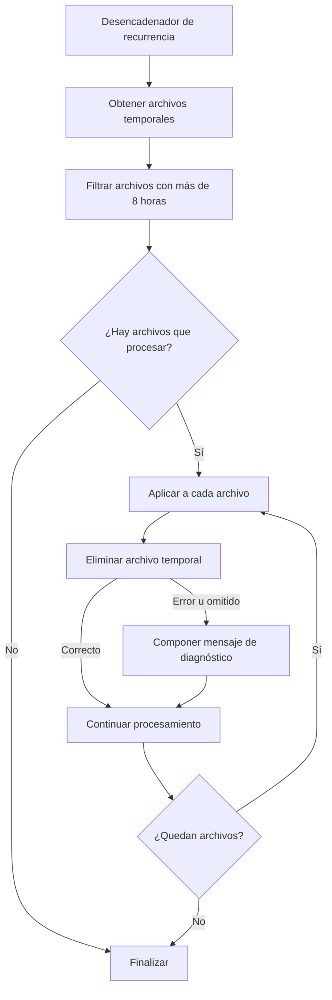

# FL03 - Limpieza de archivos temporales

## Descripción general

Demostración conceptual de un flujo programado de Power Automate que elimina archivos temporales de SharePoint con más de 8 horas de antigüedad.

Todos los recursos e identificadores de SharePoint son ficticios.

## Arquitectura

### Diagrama del flujo

## Pasos del flujo

1. Ejecutarse según una programación recurrente.
2. Recuperar los archivos temporales de una biblioteca de documentos de SharePoint.
3. Filtrar los archivos con más de 8 horas de antigüedad.
4. Recorrer los archivos filtrados.
5. Eliminar cada archivo seleccionado.
6. Generar un mensaje de diagnóstico si la eliminación falla o se omite.

## Política de retención

| Configuración | Valor |
|---|---|
| Umbral de antigüedad | Más de 8 horas |
| Destino | Archivos temporales de SharePoint |
| Ejecución | Programación recurrente |
| Frecuencia exacta de recurrencia | No especificada |

## Gestión de diagnósticos

Si una acción de eliminación falla o se omite, una acción **Componer (Compose)** genera un mensaje de diagnóstico que identifica el archivo afectado y sugiere comprobar si existe un bloqueo de Excel Online.

Se trata de una medida de diagnóstico, no de un sistema completo de registro de errores o notificaciones.

## Aspectos técnicos destacados

- Diseño de un flujo en la nube programado.
- Operaciones sobre bibliotecas de documentos de SharePoint.
- Filtrado de matrices según la antigüedad de los archivos.
- Procesamiento mediante **Aplicar a cada uno (Apply to each)**.
- Eliminación automatizada de archivos temporales.
- Ejecución condicional mediante **Configurar ejecución posterior (Run after)**.
- Mensajes de diagnóstico para operaciones fallidas u omitidas.

## Estado de implementación

**Demostración conceptual. No es un flujo importable de Power Automate.**

El archivo `FL03-demo.json` describe la arquitectura prevista y no contiene definiciones ejecutables de acciones de Power Automate.

## Seguridad

- Recursos de SharePoint ficticios.
- Sin datos reales de usuarios.
- Sin credenciales ni identificadores de conexión.
- Sin exportaciones de soluciones corporativas.

## Tecnologías

- Microsoft Power Automate
- SharePoint Online
- JSON
- Mermaid
