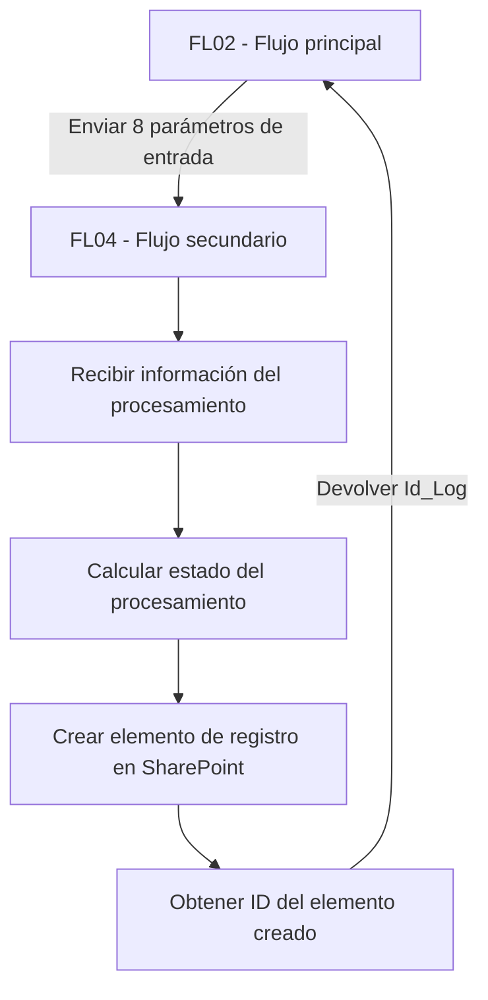

# FL04 - Registro de ejecuciones y seguimiento de errores

## Descripción general

FL04 es un flujo secundario reutilizable de Power Automate que registra los resultados del procesamiento y los errores en una lista de SharePoint Online.

Lo invoca FL02, el flujo principal de procesamiento de Excel, y devuelve el identificador del registro de ejecución recién creado.

Esta demostración conceptual ilustra el registro centralizado, la trazabilidad de las ejecuciones y la reutilización de componentes de automatización.

## Arquitectura

## Desencadenador

**Desencadenar un flujo manualmente (Manually trigger a flow)**

FL04 es invocado por FL02 y recibe ocho parámetros de entrada.

## Parámetros de entrada

| Parámetro | Tipo | Descripción |
|---|---|---|
| ProcessingReferenceId | Número | Identificador de referencia de la operación de procesamiento |
| SourceFileId | Número | Identificador del archivo de origen |
| SourceFileName | Texto | Nombre del archivo Excel procesado |
| RecordsRead | Número | Número de registros leídos |
| RecordsCreated | Número | Número de registros creados |
| RecordsWithErrors | Número | Número de registros con errores |
| ErrorDetails | Texto | Detalles de los errores de procesamiento |
| ExecutionId | Texto | Identificador utilizado para la trazabilidad de la ejecución |

## Pasos del flujo

1. Recibir los parámetros de procesamiento enviados por FL02.
2. Evaluar los resultados para determinar el estado de la ejecución.
3. Generar la marca temporal de ejecución mediante `utcNow()`.
4. Crear un elemento en la lista de registros de procesamiento de SharePoint.
5. Almacenar los recuentos de registros, los detalles de errores y los identificadores de ejecución.
6. Obtener el ID del elemento de SharePoint creado.
7. Devolver `Id_Log` al flujo principal.

## Lógica de los estados de procesamiento

El flujo determina el estado del procesamiento a partir del número de registros creados correctamente y del número de registros con errores.

| Registros creados | Registros con errores | Estado |
|---|---|---|
| Mayor que 0 | 0 | `Success` |
| Mayor que 0 | Mayor que 0 | `Partial Success` |
| 0 | Mayor que 0 | `Error` |
| 0 | 0 | `No Records` |

El estado `No Records` permite distinguir las ejecuciones que no generan registros ni notifican errores de aquellas que presentan errores registrados.

Este modelo conceptual de estados presupone que `RecordsWithErrors` refleja correctamente los fallos de procesamiento relevantes.

Durante la implementación, debe validarse la lógica de estados frente a los resultados reales del flujo principal.

### Alcance del recuento de errores

En la demostración de FL02, `RecordsWithErrors` representa únicamente las operaciones fallidas de creación de registros en SharePoint.

FL02 envía directamente a FL04 el contador `SharePointErrors` como valor de `RecordsWithErrors`.

Los errores de validación de Excel, los tipos de registro no admitidos y los fallos generales del flujo quedan excluidos de este contador.

El estado `No Records` indica que no se han creado registros y que no se han notificado errores de creación en SharePoint. **No garantiza que el flujo completo haya finalizado correctamente.**

Una implementación de producción debería registrar por separado los fallos generales del flujo para distinguir un procesamiento sin resultados de una ejecución fallida.

## Estructura del registro en SharePoint

FL04 crea registros en la lista `Processing Logs List`, ubicada en el subsitio de gestión.

El siguiente esquema está alineado con la configuración documentada de la lista de SharePoint.

| Nombre visible | Nombre interno | Tipo | Valor de FL04 |
|---|---|---|---|
| Processing Reference ID | ProcessingReferenceId | Número | inputs.ProcessingReferenceId |
| Source File ID | SourceFileId | Número | inputs.SourceFileId |
| Execution ID | ExecutionId | Una línea de texto | inputs.ExecutionId |
| Execution Date | ExecutionDate | Fecha y hora | utcNow() |
| Records Read | RecordsRead | Número | inputs.RecordsRead |
| Records Created | RecordsCreated | Número | inputs.RecordsCreated |
| Records With Errors | RecordsWithErrors | Número | inputs.RecordsWithErrors |
| Processing Status | Status | Opción | CalculatedProcessingStatus |
| Error Details | ErrorDetails | Varias líneas de texto | inputs.ErrorDetails |

### Valores del estado de procesamiento

El campo `Status` admite cuatro valores conceptuales:

- `Success`
- `Partial Success`
- `Error`
- `No Records`

Estos valores se calculan mediante `RecordsCreated` y `RecordsWithErrors`.

### Consideraciones adicionales

FL04 recibe el parámetro `SourceFileName`, pero actualmente no lo almacena en la lista de SharePoint presentada en la demostración.

El ID del elemento de SharePoint se genera automáticamente al crear el registro.

FL04 devuelve este identificador a FL02 mediante el parámetro de salida `Id_Log`.

El campo estándar `Title` de SharePoint debe configurarse adecuadamente si sigue siendo obligatorio.

Este esquema es conceptual y no representa una lista de SharePoint aprovisionada automáticamente.

Para consultar la configuración completa, véase [Lista de registros de procesamiento](../../Sharepoint/lists/processing-logs.md).

## Salida

| Parámetro | Tipo | Descripción |
|---|---|---|
| Id_Log | Número | ID del elemento de registro de SharePoint recién creado |

Esta salida permite que FL02 haga referencia al registro creado por FL04.

## Aspectos técnicos destacados

- Arquitectura reutilizable de flujos principal y secundario.
- Ejecución parametrizada de flujos.
- Registro centralizado en SharePoint.
- Cálculo condicional del estado.
- Marcas temporales de ejecución automáticas en UTC.
- Trazabilidad de las ejecuciones.
- Respuesta estructurada al flujo principal.

## Tecnologías

- Microsoft Power Automate
- SharePoint Online
- Flujos secundarios de Power Automate
- Expresiones de flujo de trabajo
- JSON
- Mermaid

## Estado de implementación

**Demostración conceptual. No es un flujo importable de Power Automate.**

El archivo `FL04-demo.json` describe la arquitectura prevista y no contiene definiciones ejecutables de acciones de Power Automate.

## Seguridad

- Sitio y lista de SharePoint ficticios.
- Sin registros reales de procesamiento.
- Sin credenciales ni identificadores corporativos.
- Sin exportaciones de soluciones propietarias.
