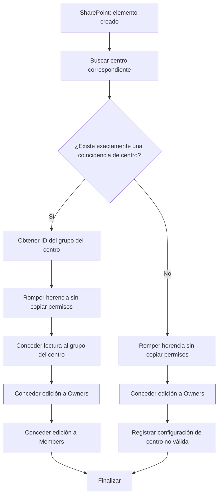

# FL05 - Permisos dinámicos de SharePoint

## Descripción general

Demostración conceptual de un flujo de Power Automate que asigna dinámicamente permisos a nivel de elemento en SharePoint Online.

El flujo utiliza una lista de configuración independiente para identificar el grupo de seguridad asociado a cada registro de negocio.

FL05 aplica un modelo de seguridad restrictivo cuando la configuración del centro no existe o está duplicada, evitando asignaciones de permisos no deseadas.

## Arquitectura

### Diagrama del flujo



El diagrama representa el proceso conceptual de asignación de permisos.

Una configuración válida requiere exactamente un registro coincidente en la lista de configuración de centros (*Centers Configuration List*).

Si la búsqueda devuelve cero o varias coincidencias, FL05 sigue la rama restrictiva.

## Pasos del flujo

1. Activarse cuando se crea un elemento en la lista de registros procesados (*Processed Records List*).
2. Buscar el centro correspondiente en la lista de configuración de centros.
3. Comprobar que existe exactamente una configuración coincidente.
4. Aplicar la estrategia de permisos a nivel de elemento que corresponda.

### Centro encontrado

Cuando se encuentra exactamente una configuración de centro:

1. Recuperar el identificador del grupo de SharePoint configurado.
2. Romper la herencia de permisos del elemento sin copiar los permisos existentes.
3. Conceder permisos de **Lectura** al grupo del centro configurado.
4. Conceder permisos de **Edición** al grupo `Owners`.
5. Conceder permisos de **Edición** al grupo `Members`.
6. Finalizar la asignación de permisos.

El JSON conceptual representa este comportamiento mediante la rama `ifTrue` de la condición `CenterFound`.

La acción de interrupción de la herencia utiliza:

```json
"copyExistingPermissions": false
```

Esto evita conservar automáticamente los permisos heredados cuando el elemento recibe su configuración de permisos exclusiva.

### Configuración de centro no válida

FL05 exige exactamente una configuración de centro coincidente.

La condición conceptual es:

```text
length(matchingRecords) = 1
```

Si no se encuentra ningún centro o varias configuraciones coinciden con el mismo centro, el flujo sigue la rama restrictiva.

El flujo:

1. Rompe la herencia de permisos del elemento sin copiar los permisos existentes.
2. Concede permisos de **Edición** al grupo `Owners`.
3. No concede permisos al grupo `Members` ni a ningún grupo de centro.
4. Registra un error de configuración mediante `LogInvalidCenterMapping`.
5. Finaliza dejando documentada la configuración de centro no válida.

El mensaje de diagnóstico es:

```text
Center configuration validation failed. No unique matching center was found in Centers Configuration List (missing or duplicate configuration). Center permissions were not granted.
```

Esto evita que una asignación de centro inexistente o ambigua conceda acceso a un grupo de SharePoint incorrecto.

El JSON conceptual todavía no valida explícitamente si el ID del grupo de SharePoint configurado es válido y utilizable. Este aspecto debe comprobarse durante la implementación.

### Consideraciones de seguridad

La rama correspondiente a una configuración de centro no válida aplica un modelo de acceso restrictivo para evitar exponer registros a grupos de otros centros.

Ambas ramas interrumpen la herencia de permisos a nivel de elemento sin copiar los permisos existentes.

En una implementación de producción, los cambios de herencia deben ejecutarse con una cuenta que disponga de privilegios suficientes.

La implementación debe garantizar que la identidad que ejecuta el flujo y los administradores autorizados conservan el acceso necesario para completar la asignación de permisos.

Los cambios de permisos y el tratamiento de errores deben probarse antes del despliegue para evitar pérdidas accidentales de acceso.

## Permisos basados en configuración

El flujo utiliza una lista de configuración de SharePoint en lugar de definir directamente en el código las relaciones entre centros y grupos.

Ejemplo con valores ficticios:

| Referencia del centro | Grupo de seguridad |
|---|---|
| REGION-A | Center-Group-A |
| REGION-B | Center-Group-B |
| REGION-C | Center-Group-C |

La lista de configuración permite que los administradores autorizados mantengan las relaciones entre centros y grupos sin modificar el flujo conceptual cada vez que cambia una asignación.

Cada centro operativo debe tener una única entrada de configuración válida.

Las asignaciones de centro duplicadas o inexistentes deben tratarse como errores de configuración.

## Matriz de permisos

El flujo aplica permisos diferentes según exista o no exactamente una configuración de centro coincidente.

| Grupo | Configuración de centro válida | Configuración de centro no válida |
|---|---|---|
| Grupo del centro configurado | Lectura | No se concede acceso |
| `Owners` | Edición | Edición |
| `Members` | Edición | No se concede acceso |
| Grupos de otros centros | No se concede acceso | No se concede acceso |

### Reglas de permisos

- Los grupos de centro reciben acceso de **Lectura** únicamente a los registros asignados a su centro.
- `Owners` recibe acceso de **Edición** en ambos escenarios.
- `Members` recibe acceso de **Edición** solo cuando existe exactamente una configuración de centro coincidente.
- No se conceden permisos a grupos de centros no relacionados.
- Las configuraciones de centro inexistentes o duplicadas se registran como errores de diagnóstico.
- La herencia de permisos se interrumpe sin copiar los permisos existentes.
- Las asignaciones de centro no válidas no deben provocar accesos no deseados.

### Consideraciones de implementación

Esta matriz describe los permisos previstos en el flujo conceptual.

Los permisos efectivos deben verificarse en SharePoint, teniendo en cuenta los administradores de la colección de sitios, la identidad que ejecuta el flujo y cualquier acceso que permanezca tras romper la herencia.

La implementación no debe asumir que romper la herencia elimina automáticamente todas las formas de acceso administrativo.

Se requiere validación adicional para:

- ID de grupos de SharePoint inexistentes o no válidos.
- Asignaciones de centro inexistentes o duplicadas.
- Usuarios que pertenecen a varios grupos de SharePoint.
- Errores durante la asignación de permisos.
- Accesos conservados por los administradores de la colección de sitios.
- Conexiones de automatización con privilegios elevados.
- Registros creados antes de que FL05 termine de asignar sus permisos.

Los permisos iniciales de los registros recién creados deben impedir accesos no deseados durante el intervalo entre la creación del elemento y la asignación de permisos por FL05.

## Aspectos técnicos destacados

- Automatización de SharePoint basada en eventos.
- Selección de grupos de seguridad basada en configuración.
- Validación de correspondencia única de centros.
- Tratamiento restrictivo de configuraciones de centro inexistentes o duplicadas.
- Recuperación dinámica de identificadores de grupo.
- Gestión de la herencia de permisos de SharePoint.
- Control de acceso a nivel de elemento.
- Integración con la API REST de SharePoint.
- Registro de diagnósticos para configuraciones no válidas.

## Tecnologías

- Microsoft Power Automate
- SharePoint Online
- SharePoint REST API
- Grupos de seguridad de SharePoint
- JSON
- Mermaid

## Estado de implementación

**Demostración conceptual. No es un flujo importable en Power Automate.**

El archivo `FL05-demo.json` describe la arquitectura del flujo y no contiene definiciones ejecutables de acciones de Power Automate.

El diseño conceptual documenta el comportamiento previsto de la asignación de permisos.

Los permisos reales de SharePoint, la resolución de grupos, el tratamiento de errores y la ejecución de la automatización requieren validación en un entorno controlado.

## Seguridad

- Sitios y listas de SharePoint ficticios.
- Referencias de centros y nombres de grupos ficticios.
- Sin datos reales de usuarios.
- Sin credenciales ni identificadores corporativos.
- Sin exportaciones de soluciones propietarias.
- Tratamiento restrictivo de permisos ante configuraciones de centro inexistentes o duplicadas.
- Requisitos explícitos de validación antes de un despliegue en producción.
